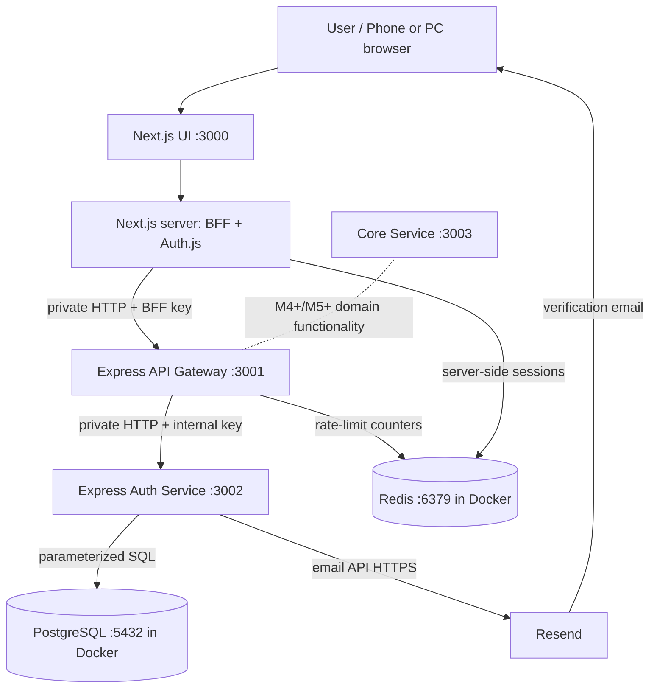
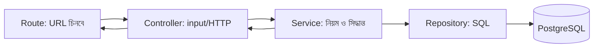
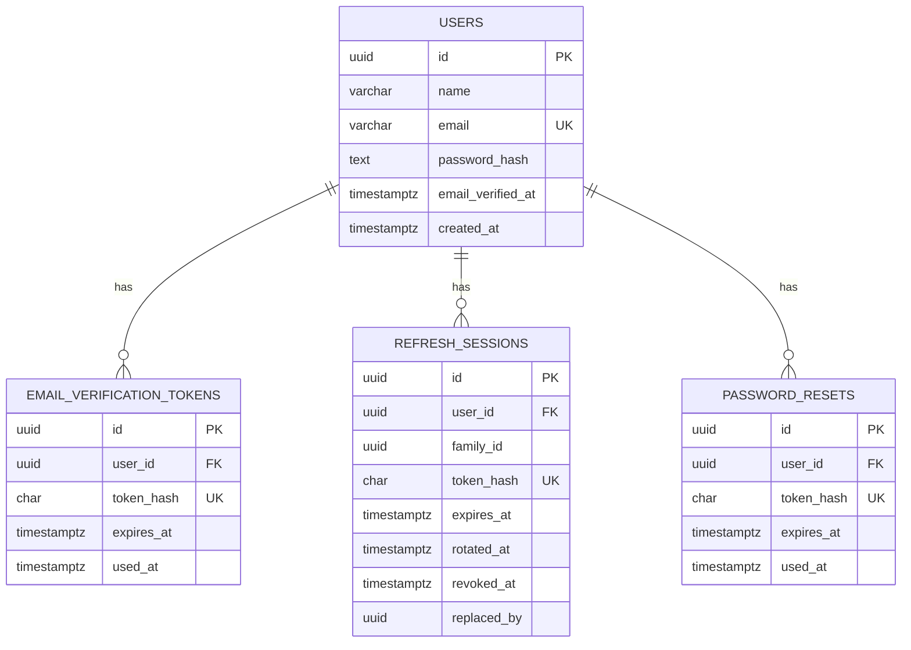
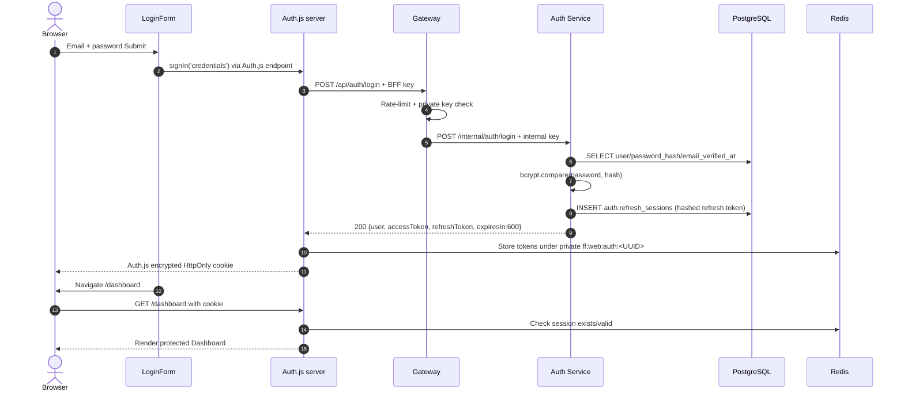
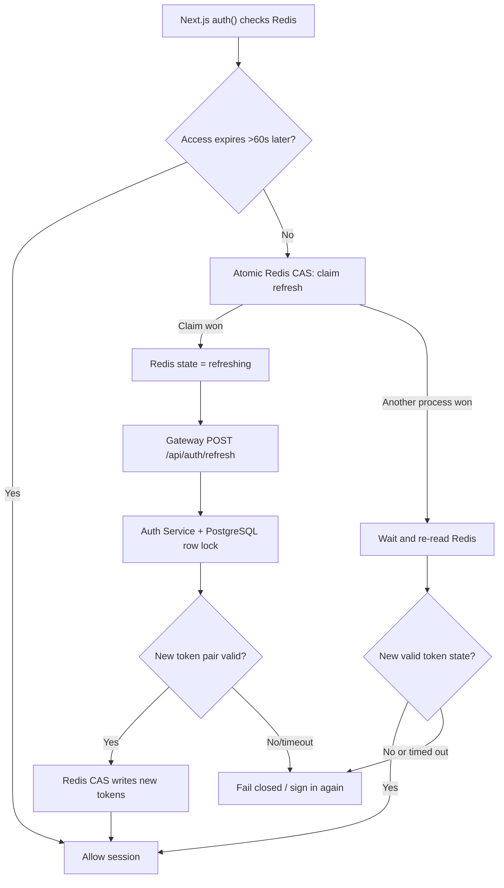
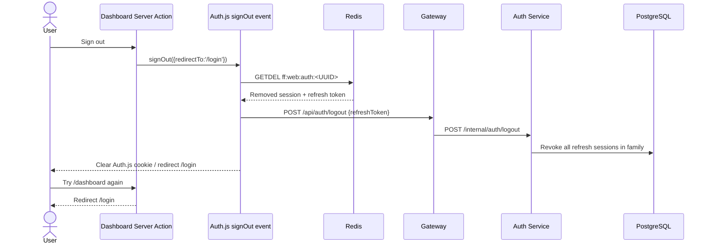
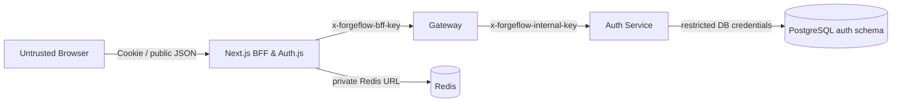
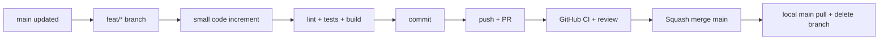

# ForgeFlow — Milestone 3 Complete Documentation

**বিষয়:** Authentication, Email Verification, Auth.js Session, JWT, Redis Refresh Rotation, Logout, Frontend–Backend Communication  
**ভাষা:** সহজ বাংলা; technical শব্দ English-এ রাখা হয়েছে  
**অবস্থা:** Milestone 3-এর মূল Authentication কাজ merged; production hardening-এর কিছু কাজ বাকি  
**শেষ আপডেট:** 18 October 2026  
**পরের কাজ:** Revised 6-Day MVP Plan v3.1 অনুযায়ী **Milestone 4 — UI Foundation, Auth Redesign & Responsive Dashboard Shell**

> **কীভাবে পড়বে:** প্রথমবার হলে ১ → ২ → ৪ → ৭ → ৯ → ১০ → ১১ পড়ো। তারপর file-map দেখে code খুলো। পুরো document পড়ার সময় প্রতিটি arrow-কে ভাববে: “কে কাকে request পাঠাল, কেন পাঠাল, কী response পেল?”
>
> **Evidence note:** এই documentation তৈরি করা হয়েছে আগের project plan, available frontend/backend source snapshot, Milestone 3 patches এবং এই chat-এ দেওয়া Git/test/browser results মিলিয়ে। এটি live GitHub checkout নয়। যেখানে owner-এর confirmation আছে, সেখানে **owner-confirmed** বলা হয়েছে; CI/deployment-এর এমন evidence দাবি করা হয়নি যা এখানে দেখা যায়নি।

---

## 0. এক মিনিটে পুরো Milestone 3

Milestone 2-তে বাড়ির **ভিত** বানানো হয়েছিল: দুই repository, Next.js, Express service skeleton, Gateway, Docker, PostgreSQL, Redis, CI এবং BFF connection।

Milestone 3-তে সেই বাড়ির **প্রধান দরজা ও পরিচয় যাচাই** তৈরি হয়েছে:

1. নতুন user **Register** করতে পারে।
2. User-এর data PostgreSQL-এ যায়; password plaintext নয়, **bcrypt hash** হিসেবে থাকে।
3. Backend **12 ঘণ্টার email verification link** বানিয়ে Resend-এর মাধ্যমে Gmail/অন্য valid mailbox-এ পাঠাতে পারে।
4. Link খুলে **Verify my email** চাপলে database-এ `email_verified_at` timestamp লেখা হয়।
5. Verified user **Login** করতে পারে; ভুল password বা unverified email reject হয়।
6. Backend **10-minute access token** এবং **rotating refresh token** তৈরি করে।
7. Next.js server backend tokens **Redis-এ** রাখে; browser-এ backend tokens দেয় না।
8. Auth.js-এর **HttpOnly encrypted session cookie** দিয়ে user authenticated থাকে।
9. `/dashboard` কেবল valid session-এ খোলে।
10. Access token expire হওয়ার কাছাকাছি Redis-coordinated **single refresh** হয়।
11. **Sign out** করলে local Redis session delete হয়, Backend-এ refresh-token family revoke করার চেষ্টা হয়।
12. Backend ও Frontend authentication changes GitHub PR-এর মাধ্যমে **main-এ merge** হয়েছে।

**এখনও তৈরি হয়নি:** বাস্তব Workspace/Project/Issue/Kanban business module, polished responsive product UI, BullMQ/Socket.IO/Billing/CRM, production deployment। Password recovery backend-এর প্রাথমিক endpoint থাকলেও frontend/real delivery end-to-end সম্পূর্ণ নয়।

---

## 1. Status: কী সত্যিই হয়েছে, কী হয়নি?

| বিষয় | এই chat-এ পাওয়া প্রমাণ | অবস্থা |
|---|---|---|
| Backend register/login/JWT/refresh/logout | Backend Auth API PR `#5`, commit ইতিহাসে `6e54889` | Merged বলে Git output-এ নিশ্চিত |
| Backend email verification | বাস্তব email এসেছে, `email_verified_at` timestamp দেখা গেছে; owner জানিয়েছেন PR merge হয়েছে | Owner-confirmed merged; squash SHA এখানে নেই |
| Frontend registration | Database-এ user তৈরি হয়েছে; BFF/component tests | Working ও merged |
| Verification | Inbox link → button → verified timestamp | Browser + DB verified |
| Resend Verification | UI/BFF tests; verified email-এ resend করলে mail না আসার আচরণ বোঝা হয়েছে | Implemented/merged; আলাদা **unverified-account resend delivery** browser evidence নেই |
| Login + `/dashboard` | Owner বলেছেন “Login successful, dashboard opens” | Browser verified + merged |
| Logout | Owner বলেছেন Sign in / Sign out দুটো কাজ করেছে | Browser verified + merged |
| Refresh rotation | Race-condition tests; fix-এর পরে owner বলেছেন সব শেষ | Owner-confirmed local tests/browser check; production load test নয় |
| Frontend GitHub PR | `f5f0ed8 feat(auth): complete frontend authentication flow (#4)` | **main-এ merged**, Git log-এ প্রমাণ |
| Backend/Frontend CI | Owner বলেছেন tests/checks pass; PR merged | Local check results পাওয়া গেছে; exact final GitHub Actions run IDs এখানে নেই |
| Final comprehensive smoke test | Owner বলেছেন আর চালাতে চান না | **Skipped by owner**; চালানো হয়েছে বলে দাবি নয় |
| Deployed website | Production URL/release evidence নেই | **Not verified / not deployed** |

### গুরুত্বপূর্ণ Git evidence

**Frontend `main`:**

```text
f5f0ed8 (HEAD -> main, origin/main, origin/HEAD)
feat(auth): complete frontend authentication flow (#4)
```

Frontend feature branch-এ final squash merge-এর আগে:

```text
12a7316  feat(auth): add registration and email verification
8ad1bba  feat(auth): add resend verification flow
1f92bab  feat(auth): add secure login and logout flow
5729ff5  feat(auth): add Redis-coordinated token refresh
```

**Backend email-verification feature commit:** `16e5cd7` — `feat(auth): add email verification and resend flow`। User পরে GitHub merge ও remote branch deletion নিশ্চিত করেছেন।

**মনে রাখবে:** “Local tests passed”, “GitHub merged”, এবং “Cloud deployed” — তিনটি আলাদা status।

---

## 2. শূন্য থেকে বোঝো: Frontend, Backend, Gateway, Database কী?

ধরো ForgeFlow একটা অফিস।

| বাস্তব অফিসের উদাহরণ | ForgeFlow-তে কার ভূমিকা? |
|---|---|
| অফিসের সুন্দর Reception/ফর্ম | **Frontend (Next.js + React)**: Login/Register screen, button, message |
| Reception-এর private desk | **Next.js BFF / Auth.js server**: browser-এর হয়ে নিরাপদ request করে |
| Main gate + security guard | **API Gateway (Express)**: কোন request যাবে, key আছে কিনা, rate-limit |
| পরিচয়পত্র যাচাই করা বিভাগ | **Auth Service (Express)**: user/password/token-এর business rules |
| অফিসের স্থায়ী রেজিস্টার | **PostgreSQL**: user, email verification, refresh-session records |
| দ্রুত অস্থায়ী locker | **Redis**: rate-limit counters ও Next.js-এর server-side login tokens |
| ডাকবাহক | **Resend**: আসল verification email পাঠায় |
| পরিচয়পত্র/চাবি | **JWT access token / refresh token** |

### Frontend কি PostgreSQL-এ সরাসরি SQL চালায়?

**না।** Browser কখনো `auth.users` table-এ SQL চালায় না। Browser form data পাঠায়; Backend যাচাই করে repository-এর SQL দিয়ে PostgreSQL-এ write করে।

### Backend কি page design করে?

**না।** Backend সাধারণত JSON response দেয়। Frontend সেই response দেখে কোন screen/message দেখাবে ঠিক করে।

### তাহলে Next.js-কে Frontend বলেও server-এর কথা বলছি কেন?

কারণ Next.js-এ দুই দিক আছে:

- **Browser/Client side:** `"use client"` React components, button click, form typing।
- **Server side:** Route Handlers, Server Components, Auth.js callbacks, private environment variables।

তাই `Frontend repository` মানেই সব code browser-এ চলে না। **BFF code browser থেকে আলাদা server process-এ চলে।**

---

## 3. দুই Repository — সম্পূর্ণ আলাদা Git history

লোকাল Windows path:

```text
E:/ForgeFlow/
├── forgeflow-frontend/    # Next.js UI, Auth.js, BFF, browser session
└── forgeflow-backend/     # Gateway, Auth, Core, migrations, Docker services
```

এই দুই repository-তে আলাদা `package.json`, dependency lockfile, Git branch, CI, PR, Docker build।

| Frontend repository | Backend repository |
|---|---|
| `/login`, `/register`, `/verify-email` দেখায় | `/api/auth/login`, `/api/auth/register`, `/api/auth/email/verify` process করে |
| Form validation / loading / error feedback | Database-level rules, bcrypt, token issuance |
| Browser cookie ও BFF interface | JWT verification, refresh-session rotation |
| Redis server-side login session record রাখে | PostgreSQL-এ durable refresh-session record রাখে |
| `main` PR #4 merged | Auth API PR #5 ও email-verification PR owner-confirmed merged |

**পরের milestone-এও ঠিক দুই repository থাকবে।** Core Service backend repo-র মধ্যেই থাকবে; নতুন Workspace microservice বা তৃতীয় repo বানানো হবে না।

---

## 4. পুরো System Architecture — এক ছবিতে



**Local host ports:**

| কী | Browser/host side | Docker internal port | কাজ |
|---|---|---|---|
| Next.js | `localhost:3000` | `3000` | UI + BFF + Auth.js |
| Gateway | `127.0.0.1:3001` | `3001` | Authentication route gateway |
| Auth Service | Local dev `3002` | `3002`, Compose-এ private | User/password/token logic |
| Core Service | Local dev `3003` | `3003`, Compose-এ private | বর্তমানে মূলত foundation; পরে workspace/projects |
| PostgreSQL | `127.0.0.1:5433` | `5432` | Durable records |
| Redis | `127.0.0.1:6380` | `6379` | Session + rate limits |

**কেন Postgres host 5433 কিন্তু container 5432?** Docker mapping `5433:5432`। বাইরের pgAdmin `5433` ব্যবহার করে, container-এর ভেতর `5432`। একইভাবে Redis host `6380`, container `6379`।

### সবচেয়ে জরুরি HTTP পথ

```text
Browser
   | 1. form submit / page request
   v
Next.js (UI + private server/BFF)
   | 2. server-to-server request
   v
Gateway
   | 3. authenticate / limit / proxy
   v
Auth Service
   | 4. SQL read/write
   v
PostgreSQL
   | 5. result returns reverse direction
   v
Auth Service → Gateway → Next.js → Browser
```

কোনো request-এর **উত্তর সাধারণত উল্টো পথে ফিরে আসে**। UI যা দেখায়, তা সেই returned status/JSON-এর ভিত্তিতে।

---

## 5. কোন File-এর কাজ কী? — প্রথমে এই map দেখো

### 5.1 Frontend tree: Milestone 3-এর গুরুত্বপূর্ণ files

```text
forgeflow-frontend/
├── src/
│   ├── app/
│   │   ├── (auth)/
│   │   │   ├── register/page.js
│   │   │   ├── login/page.js
│   │   │   ├── verify-email/page.js
│   │   │   └── resend-verification/page.js
│   │   ├── (protected)/dashboard/page.js
│   │   └── api/
│   │       ├── backend/auth/register/route.js
│   │       ├── backend/auth/email/verify/route.js
│   │       ├── backend/auth/email/resend/route.js
│   │       └── auth/[...nextauth]/route.js
│   ├── auth.js
│   ├── features/auth/
│   │   ├── register-schema.js
│   │   ├── login-schema.js
│   │   ├── resend-schema.js
│   │   ├── components/
│   │   │   ├── register-form.jsx
│   │   │   ├── login-form.jsx
│   │   │   ├── verify-email-form.jsx
│   │   │   └── resend-verification-form.jsx
│   │   └── server/
│   │       ├── login-gateway.js
│   │       ├── refresh-gateway.js
│   │       ├── logout-gateway.js
│   │       └── session-store.js
│   └── components/ui/
│       ├── button.jsx
│       ├── input.jsx
│       └── ...
├── tests/bff/
├── tests/components/
├── docs/
│   ├── milestone-3-login-slice.md
│   ├── milestone-3-logout-slice.md
│   └── milestone-3-refresh-slice.md
├── .env.local                 # PRIVATE; never commit
├── Dockerfile
└── package.json
```

Next.js-এর `(auth)` ও `(protected)` **route group**, URL-এর অংশ নয়। তাই `src/app/(auth)/login/page.js`-এর URL `/login`, `/(auth)/login` নয়।

| File | এক লাইনের কাজ | কে call করে? |
|---|---|---|
| `(auth)/register/page.js` | Register page-এর layout/heading | Browser যখন `/register` খোলে |
| `register-form.jsx` | Input, validation, submit, success/error | Register page |
| `register-schema.js` | Client/BFF data format check | Register form এবং BFF |
| `api/backend/auth/register/route.js` | Public BFF request validate করে Gateway-তে পাঠায় | Register form-এর `fetch` |
| `(auth)/verify-email/page.js` | Verification screen | Email-এর link |
| `verify-email-form.jsx` | Token পড়া ও button click-এর পরে POST | Verification page |
| `api/backend/auth/email/verify/route.js` | Verification BFF | Verify form-এর `fetch` |
| `(auth)/resend-verification/page.js` | Resend page | Registration/verification screen-এর link |
| `resend-verification-form.jsx` | নতুন link request করে | Resend page |
| `api/backend/auth/email/resend/route.js` | Resend BFF | Resend form-এর `fetch` |
| `(auth)/login/page.js` | Login screen | Browser `/login` খোলে |
| `login-form.jsx` | React Hook Form দিয়ে Login, `signIn()` call | Login page |
| `api/auth/[...nextauth]/route.js` | Auth.js-এর built-in handler expose করে | Auth.js/Browser auth requests |
| `src/auth.js` | Auth.js Credentials, callbacks, session, signOut event | Auth.js route, dashboard |
| `login-gateway.js` | Server থেকে Gateway login call | Auth.js `authorize()` |
| `session-store.js` | Redis session, refresh lock, invalidation | Auth.js `jwt()`/signOut callback |
| `refresh-gateway.js` | Backend refresh token rotate request | `session-store.js` |
| `logout-gateway.js` | Backend logout request | `session-store.js` |
| `(protected)/dashboard/page.js` | `auth()` দিয়ে permission to view চেক | `/dashboard` request |

### 5.2 Backend tree: Milestone 3-এর গুরুত্বপূর্ণ files

```text
forgeflow-backend/
├── apps/
│   ├── api-gateway/src/
│   │   ├── server.js
│   │   ├── app.js
│   │   ├── clients/auth-client.js
│   │   └── middleware/auth-limits.js
│   ├── auth-service/src/
│   │   ├── server.js
│   │   ├── app.js
│   │   ├── db/pool.js
│   │   └── modules/auth/
│   │       ├── auth.routes.js
│   │       ├── auth.controller.js
│   │       ├── auth.schema.js
│   │       ├── auth.service.js
│   │       ├── auth.repository.js
│   │       ├── auth.errors.js
│   │       ├── verification-mail.js
│   │       └── reset-mail.js
│   └── core-service/                  # ভবিষ্যৎ business modules
├── shared/
│   ├── auth-security.js
│   ├── http.js
│   └── ...
├── migrations/
│   ├── 001_create_service_schemas.js
│   ├── 002_create_auth_users.js
│   ├── 003_create_auth_sessions_and_resets.js
│   └── 004_add_email_verification.js
├── tests/
│   ├── integration/auth-flow.test.js
│   ├── integration/email-verification.test.js
│   ├── auth-api.test.js
│   ├── verification-mail.test.js
│   └── ...
├── compose.yml
├── compose.apps.yml
├── .env                       # PRIVATE; never commit
└── package.json
```

| File | কাজ |
|---|---|
| Gateway `app.js` | Public `/api/auth/...` routes সেট করে; BFF key পরীক্ষা |
| `auth-limits.js` | Redis-backed rate limiting; 429/503 |
| `auth-client.js` | Approved route Auth Service-এ forward করে; internal key দেয় |
| Auth Service `server.js` | Database pool, repository, business service, email sender তৈরি করে |
| Auth Service `app.js` | `/internal/auth` route attach করে |
| `auth.routes.js` | URL + HTTP method → controller method map করে |
| `auth.controller.js` | Request validate, service call, HTTP response তৈরি |
| `auth.schema.js` | Zod input rules |
| `auth.service.js` | Registration/login/verify/refresh/logout-এর **আসল business rules** |
| `auth.repository.js` | PostgreSQL SQL statements/transactions |
| `verification-mail.js` | Link বানায়, Resend/local-file mail পাঠায় |
| `shared/auth-security.js` | bcrypt নয়; opaque tokens, hashing, RSA JWT sign/verify helpers |
| `migrations/00*.js` | Version অনুযায়ী DB table/column তৈরি |

### 5.3 পাঁচ স্তরের chain — এটা বুঝলে backend অনেক সহজ



উদাহরণ: User-এর email verify করার দায়িত্ব **Service**-এর। Controller শুধু token validate করে Service call করবে। Repository ঠিক SQL execute করবে। **SQL form component-এ কিংবা Controller-এ রাখব না।**

---

## 6. PostgreSQL: Database-এ আসলে কী থাকে?

Database-এর নাম local Compose configuration-এ সাধারণত `forgeflow_dev`। `auth` এবং `core` দুটি schema আছে। বর্তমানে Milestone 3-এর user-related data `auth` schema-তে।

### 6.1 চারটি versioned migration

| Migration | কী বানিয়েছে? |
|---|---|
| `001_create_service_schemas.js` | `auth`/`core` schema ও restricted runtime permissions |
| `002_create_auth_users.js` | `auth.users` |
| `003_create_auth_sessions_and_resets.js` | `auth.refresh_sessions`, `auth.password_resets` |
| `004_add_email_verification.js` | `auth.users.email_verified_at`, `auth.email_verification_tokens` |

**Migration** মানে database-এর structure আপডেট করার versioned instruction। একবার migration production DB-তে apply হলে পুরোনো migration edit না করে নতুন numbered migration যোগ করতে হয়।

### 6.2 সহজ ER diagram



### 6.3 প্রতিটি table মনে রাখার সহজ উপায়

**`auth.users`:** মানুষটি কে?

- `id`: unique UUID — একই নামের বহু user থাকতে পারে, ID আলাদা।
- `name`: display name।
- `email`: lowercase/normalized, unique।
- `password_hash`: bcrypt hash; plaintext password নয়।
- `email_verified_at`: `NULL` = verify হয়নি; timestamp = verify হয়েছে।

**`auth.email_verification_tokens`:** Email যাচাই করার একবারের ticket।

- `user_id`: ticket কার?
- `token_hash`: আসল email link-এর raw token নয়, SHA-256 hash।
- `expires_at`: 12 ঘণ্টার limit।
- `used_at`: token consumed/invalidated হয়েছে কিনা।

**`auth.refresh_sessions`:** দীর্ঘ মেয়াদে token ঘুরিয়ে user-এর login চালু রাখার record।

- `family_id`: এক Login থেকে আসা related refresh tokens-এর family।
- `token_hash`: actual secret token-এর SHA-256 hash।
- `rotated_at`: old token replace হয়েছে।
- `replaced_by`: পরবর্তী session record-এর ID।
- `revoked_at`: logout/reuse-এর কারণে family invalid।

**`auth.password_resets`:** Future password recovery-এর one-time tickets; এখন frontend recovery complete নয়।

### 6.4 Transaction কেন দরকার?

Registration-এ **user row** এবং **verification token row** দুটোই একসঙ্গে successful হওয়া দরকার।

```text
BEGIN
  INSERT auth.users
  INSERT auth.email_verification_tokens
COMMIT
```

দ্বিতীয় insert fail হলে `ROLLBACK`: database-এ অর্ধেক register করা state তৈরি হবে না। `auth.repository.js` একবার `pool.connect()` করে একই `client` দিয়ে transaction চালায়, শেষে release করে।

### 6.5 Parameterized SQL কী?

ভুল: user input string দিয়ে SQL join করা।

সঠিক pattern:

```sql
SELECT id, name, email
FROM auth.users
WHERE email = $1;
```

`[$emailValue]` parameter হিসেবে database driver-এ যায়; user string-কে SQL command হিসেবে execute করা হয় না। এভাবেই SQL injection risk কমানো হয়।

### 6.6 pgAdmin-এ কী দেখতে পারবে?

```sql
SELECT id, name, email, email_verified_at, created_at
FROM auth.users
ORDER BY created_at DESC
LIMIT 20;
```

এই query-তে password hash বা private token-এর দরকার নেই। Real email, token, screenshot share করার আগে sensitive তথ্য hide করবে।

**Verification-এর বাস্তব প্রমাণ:** `email_verified_at`-এ UTC timestamp দেখা গিয়েছিল; `NULL` ছিল না।

---

## 7. Registration: User “Create account” চাপলে কী হয়?

ধরো একজন user নাম, email, password দিয়ে Submit করলেন।

```mermaid
sequenceDiagram
    autonumber
    actor U as Browser user
    participant UI as RegisterForm
    participant B as Next BFF register route
    participant G as Gateway
    participant A as Auth Service
    participant DB as PostgreSQL
    participant E as Resend
    U->>UI: নাম + email + password, Submit
    UI->>UI: React Hook Form + Zod validation
    UI->>B: POST /api/backend/auth/register
    B->>B: Origin, JSON, size, schema validation
    B->>G: POST /api/auth/register + private BFF key
    G->>G: Key check + Redis rate limit
    G->>A: POST /internal/auth/register + internal key
    A->>A: bcrypt hash + random verification token
    A->>DB: BEGIN; insert user + hashed token; COMMIT
    DB-->>A: Stored
    A->>E: Email verification link (HTTPS)
    A-->>G: 201 + safe user fields
    G-->>B: 201
    B-->>UI: 201 safe JSON
    UI-->>U: Check your email
```

### Exact file-to-file path

```text
/register
  └─ src/app/(auth)/register/page.js
       └─ src/features/auth/components/register-form.jsx
            ├─ src/features/auth/register-schema.js
            └─ fetch('/api/backend/auth/register')
                 └─ src/app/api/backend/auth/register/route.js
                      └─ Gateway apps/api-gateway/src/app.js
                           ├─ middleware/auth-limits.js
                           └─ clients/auth-client.js
                                └─ Auth Service auth.routes.js
                                     └─ auth.controller.js (register)
                                          └─ auth.service.js (register)
                                               ├─ bcrypt.hash(..., 12)
                                               ├─ auth.repository.js → auth.users
                                               ├─ auth.repository.js → auth.email_verification_tokens
                                               └─ verification-mail.js → Resend
```

### কোন data কোথায় থাকে?

| Data | পাঠানো/রাখা হয় কোথায়? |
|---|---|
| Typed name/email/password | Browser form → BFF → Gateway → Auth (HTTPS in hosted environment) |
| Plaintext password | শুধু request-এর প্রয়োজনীয় transit-এ; database-এ plaintext রাখা হয় না |
| bcrypt password hash | `auth.users.password_hash` |
| New user ID | `auth.users.id` এবং safe response |
| Random verification token | Email URL-এ raw; DB-এ কেবল hash |
| Verification expiry | `auth.email_verification_tokens.expires_at` |

**HTTP `201 Created`:** User DB-তে created হয়েছে। **এটি email inbox-এ পৌঁছেছে তার guarantee নয়।** Code প্রথমে DB commit করে, পরে mail পাঠায়। Mail provider fail করলে error log হয়, account unverified থাকে, পরে resend করা যায়।

### Registration validation/rate limit

- Name nonblank, max 120 characters।
- Email canonical lowercase, max 254 chars।
- Register password min 12 characters, bcrypt-এর 72 UTF-8 byte bound।
- Duplicate email → `409 EMAIL_TAKEN`।
- Gateway registration limit source অনুযায়ী 10/hour/IP এবং 3/hour/IP+email।
- Redis limiter down → guarded route-এ controlled `503`।

---

## 8. Email Verification: Gmail link কেন এবং কীভাবে কাজ করে?

### 8.1 Register আর Verify কি একই কাজ?

**না।** Register প্রমাণ করে form পূরণ করা হয়েছে; Verify প্রমাণ করে mailbox-এ যাওয়া link পাওয়া গেছে। শুধু email address লিখলেই সেটির মালিকানা প্রমাণ হয় না।

### 8.2 Mail তৈরি হওয়ার গল্প

1. `auth.service.js` 32-byte random opaque token তৈরি করে।
2. Token-এর **SHA-256 hash** DB-তে রাখে।
3. `verification-mail.js` এই রকম link বানায় (token এখানে deliberately fake):

   ```text
   http://localhost:3000/verify-email?token=EXAMPLE_RANDOM_SECRET
   ```

4. `AUTH_EMAIL_MODE=resend` থাকলে Resend-এর `POST https://api.resend.com/emails` call হয়।
5. Resend provider request accept করলে email delivery process শুরু করে। Recipient provider Gmail/Outlook/নিজের domain যেকোনো হতে পারে।
6. Real inbox-এ email এসেছে—এই milestone-এ সেই browser verification পাওয়া গেছে।

Local `file` mode-ও আছে: development-এ ignored JSONL outbox-এ link লেখা যায়; **এটা real email নয়**।

### 8.3 কেন link click করলেই verification হয় না?

কিছু email client/security scanner link preview করে। যদি GET request-এই token consume হয়, user button চাপার আগেই verify হয়ে যেতে পারে। তাই current implementation:

```mermaid
sequenceDiagram
    actor U as Email owner
    participant Page as /verify-email page
    participant Form as VerifyEmailForm
    participant B as BFF verify route
    participant G as Gateway
    participant A as Auth Service
    participant DB as PostgreSQL
    U->>Page: Email link open (GET)
    Page->>Form: Query string-এর token
    Note over Page,Form: Link open করলেই DB change নয়
    U->>Form: Verify my email click
    Form->>B: POST /api/backend/auth/email/verify {token}
    B->>G: POST /api/auth/email/verify
    G->>A: POST /internal/auth/email/verify
    A->>DB: token hash খুঁজে lock + expiry check
    A->>DB: email_verified_at = NOW(); invalidate tokens; COMMIT
    A-->>B: 204 No Content (Gateway হয়ে)
    B-->>Form: 204
    Form-->>U: Verified successfully → Sign in
```

### 8.4 Backend কী কী চেক করে?

- Token database-এ আছে?
- Raw token-এর hash মিলছে?
- Token expired নয় তো? (**12 ঘণ্টা**)
- আগে used নয় তো?
- User আগে verified নয় তো?
- Transaction lock নেওয়া যাচ্ছে তো?

Valid হলে `auth.users.email_verified_at = NOW()` হয়; ওই user-এর অন্য outstanding verification tokens invalidated হয়। Same token আবার ব্যবহার করলে invalid/expired response।

### 8.5 Gmail link কাজ করছিল না—কেন?

প্রথমে backend email `/verify-email` link পাঠালেও frontend-এ ওই page ছিল না। তাই browser-এ খুলে আটকে যাচ্ছিল। পরে:

- `(auth)/verify-email/page.js`
- `features/auth/components/verify-email-form.jsx`
- `api/backend/auth/email/verify/route.js`

যোগ করার পর **Verify my email** button কাজ করেছে এবং pgAdmin timestamp নিশ্চিত করেছে।

**Phone-এ `localhost` link:** Phone থেকে খুললে `localhost` মানে **phone নিজেই**, তোমার PC নয়। Local dev URL তাই একই PC-তে খোলা হয়েছিল। Hosted deployment-এ HTTPS public frontend domain লাগবে।

---

## 9. Resend Verification: কখন mail যাবে, কখন যাবে না?

Flow:

```text
/resend-verification
  └─ resend-verification-form.jsx
       └─ POST /api/backend/auth/email/resend
            └─ Gateway /api/auth/email/resend
                 └─ Auth Service resendEmail()
                      ├─ User নেই → no email
                      ├─ User already verified → no email
                      └─ User unverified → old tokens invalid
                           → new 12-hour hashed token
                           → Resend mail
```

**তিন ক্ষেত্রেই public success message একই ধরনের generic `202 Accepted`**:

> If this account needs verification, a new link will be sent.

কারণ, কেউ শুধু email দিয়ে registered account আছে কিনা খুঁজে বের করতে পারা উচিত নয়। একে **account enumeration prevention** বলে।

### এই chat-এ যা হয়েছিল

তুমি আগের verified email দিয়ে resend request করেছিলে। UI success message দেখালেও Resend Dashboard-এ নতুন email ছিল না। **এটাই expected**: verified user-এর আবার verification প্রয়োজন নেই।

একটি **নতুন unverified user**-এর email দিয়ে actual resend delivery verify করার separate browser result এই conversation-এ পাওয়া যায়নি। তাই code/tests merged হলেও সেই নির্দিষ্ট scenario pending evidence হিসেবে ধরা হবে।

Gateway resend rate-limit source অনুযায়ী 20/hour/IP এবং 3/hour/IP+email। নতুন resend পুরোনো link invalidate করে; পুরোনো link দিয়ে আর Verify করা যাবে না।

---

## 10. Login: এখানে Auth.js কেন? JWT আর Cookie এক জিনিস?

### 10.1 সবচেয়ে ছোট উত্তর

**Auth Service** user-এর password সঠিক কিনা যাচাই করে; **Auth.js** browser-এর session সামলায়।

- **Backend Access JWT:** Gateway/Auth API-তে user identity প্রমাণের জন্য server-side token।
- **Backend Refresh Token:** Access token expire হলে নতুন token নেওয়ার secret; rotate হয়।
- **Auth.js Session Cookie:** Browser-এ session ধরে রাখার encrypted, HttpOnly cookie; **backend access/refresh token নয়**।
- **Redis Session Record:** Next.js server-এর private locker—Backend tokens এখানেই থাকে।

### 10.2 Login sequence — একেবারে শুরু থেকে



### 10.3 Frontend exact call chain

```text
/login
  → (auth)/login/page.js
    → features/auth/components/login-form.jsx
      → signIn('credentials', ...)
        → app/api/auth/[...nextauth]/route.js
          → src/auth.js / Credentials.authorize()
            → features/auth/server/login-gateway.js
              → Gateway POST /api/auth/login
                → Auth Service /internal/auth/login
                  → auth.controller.js → auth.service.js → auth.repository.js
                    → PostgreSQL auth.users + auth.refresh_sessions
              ← safe user + JWT access token + rotating refresh token
            → features/auth/server/session-store.js createServerSession()
              → Redis ff:web:auth:<UUID>
          → Auth.js HttpOnly encrypted cookie (opaque session ID)
  → /dashboard
```

**বিশেষ খেয়াল:** Login form সরাসরি custom `/api/backend/auth/login` route call করছে **না**। Auth.js-এর `signIn()` call থেকে Auth.js handler/server-এর `authorize()` হয়ে Gateway call হচ্ছে।

### 10.4 Password মিলানোর logic

`auth.service.js` user খোঁজে, `bcrypt.compare()` দিয়ে password পরীক্ষা করে, `email_verified_at` আছে কিনা দেখে।

- Wrong password/unknown account → `401` generic invalid credentials।
- Correct password কিন্তু email unverified → `403 EMAIL_NOT_VERIFIED`।
- Too many attempts → `429`।
- সঠিক verified user → `200` token pair।

Unknown account-এর ক্ষেত্রেও dummy password hash comparison আছে—timing variation কমানোর defence।

### 10.5 Access Token এবং Refresh Token কতক্ষণ থাকে?

| বিষয় | Lifetime (source) | কোথায় থাকে? |
|---|---|---|
| JWT access token | **600 seconds = 10 minutes** | Auth Service তৈরি করে; Next.js-এর Redis record |
| Backend refresh session | **30 days** (DB record expiry) | Raw token Redis record-এ; DB-তে কেবল hash |
| Auth.js browser session maxAge | **24 hours configured** | Encrypted HttpOnly cookie |
| Next.js Redis login-session TTL | **24 hours after create/refresh** | Redis key `ff:web:auth:<UUID>` |
| Email verification | **12 hours** | Token hash PostgreSQL-এ, raw link email-এ |
| Password reset token | **15 minutes** | Backend-only initial implementation |

**30-day backend refresh expiry ≠ 30-day browser login।** Auth.js cookie/session settings আরও সীমা দেয়। Redis-এর TTL successful refresh-এ আবার 24h সেট হয়; তাই “login হওয়ার ঠিক 24 ঘণ্টা পর যেকোনো activity-তেও terminate হবেই” বলা ঠিক নয়।

### 10.6 JWT-এর signature কেন জরুরি?

Auth Service নিজের **RSA private key** দিয়ে RS256 JWT sign করে; Gateway matching **public key** দিয়ে verify করে। JWT payload-এ `sub`, `iss`, `aud`, `iat`, `nbf`, `exp`, `jti`, verified-email marker `ev:true` আছে।

Server পরীক্ষা করে:

- Signature আসল?
- Issuer (`iss`) ও Audience (`aud`) ঠিক?
- Expiry (`exp`) শেষ হয়নি?
- Algorithm **RS256**-ই আছে? `alg=none` গ্রহণ করে না।
- Verified email marker আছে?

**JWT encode ≠ encryption।** JWT-এর payload readable হতে পারে; তাই password/secret JWT payload-এ রাখা হয় না।

---

## 11. Redis: কেন PostgreSQL থাকতেও Redis লাগল?

দুটো storage-এর কাজ আলাদা।

| PostgreSQL | Redis |
|---|---|
| Durable user/account records | দ্রুত session lookup |
| Refresh-token hash/family/revocation | Next.js server-side raw token vault |
| Email verification & reset token hashes | Gateway shared login/register/resend rate limits |
| ACID transactions/row locks | Atomic Lua compare-and-swap (refresh coordination) |

### Next.js Redis record-এর ধারণামূলক sample

**উদাহরণ, real secret নয়:**

```json
{
  "user": { "id": "USER_UUID", "name": "Demo User", "email": "demo@example.com" },
  "accessToken": "<PRIVATE_ACCESS_TOKEN>",
  "refreshToken": "<PRIVATE_REFRESH_TOKEN>",
  "accessExpiresAt": 9999999999999
}
```

Redis key format:

```text
ff:web:auth:<random-session-UUID>
```

**সতর্কতা:** এই JSON-এ real tokens থাকে। Redis private রাখা জরুরি; database/Redis dump বা logs public করা যাবে না। Source-এ Redis token-value encryption-এর আলাদা layer পাওয়া যায়নি; Auth.js **cookie encrypted**, Redis JSON-কে encrypted-at-rest বলা যাবে না।

Browser-এর Auth.js client session response-এ শুধু `user.id`, `user.name`, `user.email` যায়। Redis session ID অথবা backend raw tokens `session()` callback-এর result-এ যায় না।

---

## 12. Refresh Token Rotation — পুরো Milestone-এর সবচেয়ে tricky অংশ

### 12.1 কেন refresh দরকার?

Access JWT মাত্র 10 মিনিট valid। ধরো user Login করে Dashboard-এ 15 মিনিট কাজ করলেন। প্রতিবার password চাইলে ব্যবহার করা কষ্টকর। তাই **refresh token** দিয়ে নতুন 10-minute access token নেওয়া যায়।

### 12.2 “Rotation” মানে কী?

```text
Login:
  access A1 (10 min)
  refresh R1 (longer-lived)

Refresh request with R1:
  Backend checks R1 → issues access A2 + refresh R2
  R1 is marked ROTATED

Next refresh:
  Use R2, NOT R1
```

একই পুরোনো R1 আবার ব্যবহার করলে Backend-এর reuse detection **পুরো refresh family revoke** করে। এটা stolen token replay প্রতিরোধের জন্য।

### 12.3 একই সময়ে দুই request হলে কী সমস্যা?

ধরো Dashboard-এর দুটি tab একসঙ্গে refresh চায়:

```text
Tab A: R1 পাঠাল → Backend R1 rotate করে R2 দিল
Tab B: R1 পাঠাল → Backend দেখে old token reused
                     → পুরো family revoke!
```

তাই শুধু `fetch('/refresh')` হলেই হবে না; **one refresher at a time** নিশ্চিত করতে হবে।

### 12.4 বর্তমান Redis-coordinated solution



**CAS = Compare And Swap**: “Redis record এখনও আমি আগে পড়া value-ই আছে? থাকলে তবেই change করো।” Source-এ Redis Lua script (`GET` compare + `SET`) ব্যবহার করা হয়েছে।

`session-store.js`-এর `hasServerSession()` login validity check-এর সময়:

1. Redis থেকে session পড়ে।
2. Access token-এ 60 seconds-এর বেশি থাকলে continue করে।
3. Expiry কাছাকাছি হলে `state:"refreshing"` atomic marker দেয়।
4. Only winning process `refresh-gateway.js` call করে।
5. Backend `/api/auth/refresh` PostgreSQL transaction-এ old refresh record lock করে, নতুন record insert করে, old record `rotated_at` mark করে।
6. Next.js new access/refresh tokens Redis-এ atomic CAS দিয়ে replace করে।
7. অন্য concurrent requests updated session দেখলে continue করে।

**এটা background timer নয়।** `auth()`/session check-এর request এলে refresh trigger হয়। User 10 মিনিট browser একদম idle রেখে ফিরে এলেও পরের session check-এ refresh হতে পারে।

### 12.5 কেন Gateway timeout হলে retry নয়?

Timeout হলেও Backend token rotate করে ফেলতে পারে; response কেবল frontend-এ পৌঁছায়নি। তখন একই old token retry করলে reuse হিসেবে ধরে পুরো family revoke হতে পারে। তাই ambiguous result-এ implementation **fail closed** করে—user-কে নতুন Login করতে হতে পারে।

### 12.6 কেন “refreshing” marker expire না হওয়া পর্যন্ত রেখে দেওয়া হতে পারে?

Refresh চলাকালে process crash করলে Backend rotate করেছে কিনা নিশ্চিত হওয়া যায় না। Source design marker-কে সাধারণ short lease-এর মতো steal করতে দেয় না। ফলে অন্য process পুরোনো refresh token replay করে না। Availability কমতে পারে, কিন্তু token-reuse security failure এড়ানো হয়।

### 12.7 Refresh চলাকালে Logout হলে?

Logout Redis key delete করে। Refresh response পরে এলেও CAS `XX` ও old-record comparison fail করবে। তাই deleted session **resurrect** করা যাবে না। Tests-এ এই race scenario অন্তর্ভুক্ত ছিল।

---

## 13. Logout: শুধু button নয়, session বন্ধ করা



### Exact file path

```text
src/app/(protected)/dashboard/page.js
   └─ Server Action: signOut()
        └─ src/auth.js: events.signOut
             └─ features/auth/server/session-store.js: revokeServerSession()
                  ├─ Redis GETDEL session key
                  └─ features/auth/server/logout-gateway.js
                       └─ Gateway /api/auth/logout
                            └─ Auth Service logout()
                                 └─ PostgreSQL auth.refresh_sessions.revoked_at
```

**দুটি আলাদা ফল:**

1. **Frontend logout:** Redis session delete + Auth.js cookie invalidation → browser আর `/dashboard` খুলতে পারবে না।
2. **Backend revocation:** Refresh-token family revoke → ওই family দিয়ে নতুন access token নেওয়া যাবে না।

### Honest limitation

যদি Gateway/Backend down থাকে, Redis record delete হলেও backend family revoke request fail করতে পারে। Source-এ future retry/outbox প্রয়োজন বলা আছে; **durable logout revocation retry এখনো নেই**। তাই “100% production-grade global logout” দাবি করব না। আগের issued access JWT নিজস্ব expiry পর্যন্ত cryptographically valid থাকতে পারে; server-side browser session revoke হওয়ার সঙ্গে JWT signature invalidate হওয়ার বিষয় এক নয়।

---

## 14. HTTP Routes / API Contract — হাতের কাছে রাখার টেবিল

| User action | Frontend-facing route | Gateway route | Auth Service internal route | Success | Important failure |
|---|---|---|---|---|---|
| Register | `POST /api/backend/auth/register` | `POST /api/auth/register` | `POST /internal/auth/register` | `201` | `400`, `409`, `429`, `503` |
| Verify email | `POST /api/backend/auth/email/verify` | `POST /api/auth/email/verify` | `POST /internal/auth/email/verify` | `204` | `400`, `429` |
| Resend email | `POST /api/backend/auth/email/resend` | `POST /api/auth/email/resend` | `POST /internal/auth/email/resend` | `202` | `429`, `503` |
| Login | Auth.js `/api/auth/*` handler | `POST /api/auth/login` | `POST /internal/auth/login` | `200` | `401`, `403`, `429` |
| Refresh | Server-only helper | `POST /api/auth/refresh` | `POST /internal/auth/refresh` | `200` | `401` |
| Logout | Auth.js `signOut()` event | `POST /api/auth/logout` | `POST /internal/auth/logout` | `204` | Backend unavailable |
| Current user | Not yet full workspace UI call path | `GET /api/auth/me` | `GET /internal/auth/me` | `200` | `401` |
| Forgot/reset password | Frontend flow not completed | `POST /api/auth/password/{forgot,reset}` | Corresponding Auth Service routes | `202`/`204` | Expired token, not configured mail |

**Note:** Login/refresh/logout-এ আলাদা public `/api/backend/auth/login` ইত্যাদি BFF routes নেই; Auth.js server helpers ব্যবহার করে। `GET /me` backend-এ আছে, কিন্তু M4-এ নতুন domain BFF বানালে resource authorization আলাদা করে design করতে হবে।

### Status code বাচ্চাদের ভাষায়

| Code | মানে |
|---|---|
| `200 OK` | কাজ হয়েছে; response-এ body আছে |
| `201 Created` | নতুন record তৈরি হয়েছে |
| `202 Accepted` | Request নেওয়া হয়েছে; email delivered-এর নিশ্চয়তা নয় |
| `204 No Content` | কাজ হয়েছে; response body নেই |
| `400 Bad Request` | Input/token invalid |
| `401 Unauthorized` | Valid login/token নেই বা ভুল credentials |
| `403 Forbidden` | Access deny, যেমন verified নয় বা private key ভুল |
| `409 Conflict` | Duplicate email বা future version conflict |
| `413 Payload Too Large` | Body limit অতিক্রম |
| `429 Too Many Requests` | Rate limit; `Retry-After` check করতে হবে |
| `502 Bad Gateway` | Upstream response/connectivity failure |
| `503 Service Unavailable` | Dependency/config/service temporarily unavailable |
| `504 Gateway Timeout` | Upstream সময়ে response দেয়নি |

---

## 15. Security: কে কাকে বিশ্বাস করে? কোন key কোথায়?

### 15.1 Trust boundaries



এই চাবিগুলো একই না:

- `GATEWAY_BFF_KEY`: trusted Next.js server → Gateway।
- `AUTH_INTERNAL_KEY`: Gateway → Auth Service।
- `AUTH_JWT_PRIVATE_KEY_B64`: Auth Service JWT **sign** করে; Gateway-তে যাবে না।
- `AUTH_JWT_PUBLIC_KEY_B64`: Gateway JWT **verify** করে।
- `AUTH_SECRET`: **Auth.js frontend server** session cookie protection-এর secret।
- `RESEND_API_KEY`: Auth Service → Resend email API।

### 15.2 Secrets কোথায় যাবে না

**কখনো নয়:** `NEXT_PUBLIC_*`, Browser `localStorage`, React component props, public config, Git commit, PR screenshot, ordinary logs, Docker image layer। `.env` ও `.env.local` ignored/secure রাখতে হবে।

### 15.3 Source-এ দেখা safeguards

- Zod input validation; strict server-side schemas।
- bcrypt password hashing (cost 12)।
- Server-only BFF Gateway URL/key; Auth.js HttpOnly cookie।
- Same-origin check for public Register/Verify/Resend BFF mutations।
- Auth.js Credentials flow-এর built-in CSRF protection।
- Request body size/timeouts and safe error responses।
- Redis-backed rate limiting; blocked requests `429`/`Retry-After`।
- Limiter unavailable → protected routes controlled `503`।
- RS256 JWT signature/issuer/audience/expiry/`ev` verification।
- SQL placeholders and DB constraints।
- One-time hashed verification/refresh/reset tokens।
- Refresh family reuse detection and Redis concurrency protection।
- JWT/backend tokens omitted from browser-facing Auth.js session।

### 15.4 What NOT to claim

- Global permission/RBAC/tenant isolation **এখন নেই**; upcoming Workspace/Core milestone-এ করতে হবে।
- Gateway-এর full general-purpose user/IP rate limiter scaling proof **এখন হয়নি**। Auth-specific Redis rules আছে।
- Multi-replica production stress/load test **এখন হয়নি**।
- Expired JWT auto-refresh logic আছে, কিন্তু future **domain API 401 → refresh → retry once** integration এখনও documented as pending।
- Logout backend failure-এর durable retry এখনও নেই।
- Password reset-এর real production mail transport এখন নেই।
- Production secrets/domain/TLS/cookie deployment settings এখনও verify করা হয়নি।

---

## 16. `.env`, Local Development, Docker — একই জিনিস না

### 16.1 Local machine (VS Code Git Bash)

**Frontend:** `E:/ForgeFlow/forgeflow-frontend/.env.local` (example names only)

```dotenv
FORGEFLOW_GATEWAY_URL=http://127.0.0.1:3001
GATEWAY_BFF_KEY=YOUR_PRIVATE_MATCHING_KEY
FORGEFLOW_SESSION_REDIS_URL=redis://127.0.0.1:6380
AUTH_SECRET=YOUR_RANDOM_SECRET
AUTH_TRUST_HOST=true
```

`AUTH_SECRET` তোমার computer-এ generate করবে; actual value কখনো documentation/Git-এ paste নয়। `AUTH_TRUST_HOST=true` কেবল controlled local development-এ ব্যবহার করা হয়েছে; production trust-host সেটিং আলাদা করে review করতে হবে।

**Backend:** `E:/ForgeFlow/forgeflow-backend/.env` (selected variable names)

```dotenv
AUTH_EMAIL_MODE=resend
AUTH_EMAIL_FROM="ForgeFlow <verify@YOUR_VERIFIED_SENDER_DOMAIN>"
AUTH_VERIFY_BASE_URL=http://localhost:3000
RESEND_API_KEY=YOUR_PRIVATE_RESEND_KEY
# Existing DB, Redis, JWT and inter-service secrets also stay here.
```

Backend-এর JWT private key এবং Auth.js `AUTH_SECRET` এক জিনিস নয়। Frontend ও Backend একই BFF key share করে, কিন্তু JWT private key share করে না।

### 16.2 দরকারি commands

Backend infrastructure:

```bash
cd /e/ForgeFlow/forgeflow-backend
docker compose up -d postgres redis
npm run db:migrate
```

Service তিনটি আলাদা terminal-এ চালানো যায়:

```bash
npm run dev:auth
npm run dev:gateway
npm run dev:core
```

Frontend:

```bash
cd /e/ForgeFlow/forgeflow-frontend
npm run dev
```

Full Compose apps ব্যবহার করলে আলাদা service command দরকার নাও হতে পারে; **Docker Compose এবং local Node processes একই public port claim করলে conflict হতে পারে**।

### 16.3 Docker container-এর ভেতর `localhost` নিয়ে ভুল

```text
Host Next.js → http://127.0.0.1:3001      (local host Gateway)
Docker Next.js → http://gateway:3001        (Docker service DNS)
Docker Gateway → http://auth:3002          (private Auth Service)
Docker Auth → postgres:5432                (private PostgreSQL)
Docker Redis users → redis:6379            (private Redis)
```

**Docker container-এর `localhost` মানে সেই container নিজেই।** তাই Next.js যদি container-এ চলে, `FORGEFLOW_GATEWAY_URL=http://127.0.0.1:3001` দিলে অন্য Gateway container-এ যাবে না।

### 16.4 Database safe operations

- Docker Desktop running থাকলে PostgreSQL/Redis service চালু থাকতে পারে।
- Container `stop`/`start` হলে named volume সাধারণত থাকে।
- **`docker compose down -v` নয়** — `-v` volume/data delete করতে পারে।
- Testing-এর জন্য `auth.users` rows manually delete করার দরকার নেই।
- Migration পুরোনো applied file edit নয়; নতুন migration file যোগ করবে।

---

## 17. Tests: আমরা কী পরীক্ষা করেছি এবং কেন?

### 17.1 Frontend test evidence

| পর্যায় | Conversation-এর result |
|---|---|
| Registration + Verify | **20/20** Vitest tests pass; lint/build pass |
| Resend initial | **29/30**; component test-এর DOM cleanup সমস্যা |
| Resend after cleanup | 30/30 হওয়ার expected fix; পরবর্তী Login checkpoint-এ tests এগিয়েছে |
| Login + Auth.js | **34/34** tests pass; একবার build route runtime config error |
| Refresh first run | **71/72**, একটি test Redis env mock না সেট করায় fail |
| Refresh fix-এর পরে | Owner জানিয়েছেন সব checks complete; final 72/72 terminal output এখানে separately pasted নয় |
| Browser | Registration, actual verification, Login → Dashboard, Sign Out, refresh test owner-confirmed |

**ব্যাখ্যা:** 72 tests pass হওয়া মানে 72টি test case green—এটা 72 জন user বা production load-এর guarantee নয়।

### 17.2 Backend test types

- `tests/auth-api.test.js`: Routes এবং response security।
- `tests/integration/auth-flow.test.js`: Register/Login/Refresh/Logout data flow।
- `tests/integration/email-verification.test.js`: Token, expiry, verification, resend, access restriction।
- `tests/verification-mail.test.js`: Email sender / provider request behavior।
- Gateway/auth limits and security helpers-এর অন্য unit/integration tests-ও আছে।

Owner বলেছেন Backend tests passed, কিন্তু exact final console counts এখানে দেওয়া হয়নি।

### 17.3 Common checks

Frontend:

```bash
npm run lint
npm test
npm run build
```

Backend:

```bash
npm run check
npm run test:integration
```

`npm run check` Backend package-এ lint + unit tests চালায়; integration আলাদা script। CI-তে configured checks latest commit-এ green কিনা PR-তে দেখা প্রয়োজন।

### 17.4 Browser test examples

1. Unverified account → Login reject।
2. Verification link → button click → timestamp DB-তে।
3. Verified account → Login → Dashboard।
4. Wrong password → safe generic error।
5. Anonymous user → `/dashboard` redirect `/login`।
6. Sign out → Dashboard আর accessible নয়।
7. Access token expiry-এর পরে session check → valid refresh হলে login ছাড়াই continue।
8. Concurrent refresh → duplicate old token না পাঠানো (unit-level Redis fake test)।
9. Resend unverified email → real delivery (still worth future final verification; no separate evidence here)।

---

## 18. এই Chat-এ পাওয়া Error এবং কী শিখেছি

### Error A — `Registration is temporarily unavailable` / 504

- Direct `curl http://127.0.0.1:3001/health/ready` → `200`।
- Node `fetch()` দিয়েও Gateway → `200`।
- কিন্তু Next.js BFF health request একসময় `504`।
- `netstat`-এ port **3000-এ দুটি listening PID** দেখা গিয়েছিল। Local Next.js বনাম Docker app process/hostname mismatch সম্ভাবনা ছিল।
- Frontend `npm run dev` restart-এর পর Registration সফল হয়েছে।

**শিক্ষা:** Browser-এর error message দেখে database খারাপ ধরে নেওয়া যাবে না। আগে কোন process/port/hostname-এ request যাচ্ছে খুঁজবে। এই incident-এর exact process/root cause final proof নেই; restart-এর পরে resolved হয়েছে।

### Error B — Email link আছে, page খুলছে না

Backend mail link তৈরি হয়েছিল কিন্তু `/verify-email` frontend route তখনো ছিল না। Frontend page+BFF যোগের পরে কাজ করেছে।

**শিক্ষা:** Backend endpoint implement করলেই user workflow complete হয় না; link destination page-ও থাকতে হবে।

### Error C — Verified account-এ resend করলে email নেই

Backend intentionally already-verified account-এ নতুন verification mail পাঠায় না। UI generic 202 দেখায়।

**শিক্ষা:** `202` মানে delivery guarantee নয়।

### Error D — Login shows `Invalid email or password` even with correct credentials

Auth.js `authorize()` callback credentials object-এ `csrfToken`/`callbackUrl`-এর মতো extra fields আসতে পারে। `loginWithGateway()` strict schema-তে পুরো object দিলে reject হতে পারে। Fix: **শুধু `email` ও `password` pick করে** Gateway client call। তারপর real Login সফল হয়েছে।

### Error E — Git Bash `stdin is not a tty`

আগের diagnostic command-এ `read` + heredoc/terminal interaction একসঙ্গে সমস্যা করেছিল। Test result আসেনি; এটাকে login API failure ধরে নেওয়া ভুল।

### Error F — Vitest `No test files found`

`*.test.js` file config-এর `*.test.jsx` matching-এ ধরা পড়ছিল না। Test files `.test.jsx` rename করা হয়েছে।

### Error G — `Found multiple elements with role button`

React Testing Library component test-এ আগের render cleanup না হওয়ায় দুই button একসঙ্গে ছিল। `cleanup()` যোগ করে isolation fix করা হয়েছে।

### Error H — Next.js 16 build says `runtime` incompatible with `cacheComponents`

File: `src/app/api/auth/[...nextauth]/route.js`। `export const runtime = "nodejs"` সরানো হয়েছে; default Node runtime ব্যবহার করা হয়।

### Error I — Refresh test: `Server session Redis is not configured`

Vitest test Redis fake ব্যবহার করলেও required env stub ছিল না। Test-only env/mock setup fix করা হয়েছে; production Redis safety check remove করা হয়নি।

### Error J — `git apply`: `.gitignore already exists`

Login patch ভুল করে existing `.gitignore`-কে new file হিসেবে add করছিল। Corrected patch দেওয়া হয়েছিল; existing repo file overwrite করা হয়নি।

**General debugging rule:** Browser → Next.js terminal → Gateway terminal → Auth terminal → PostgreSQL/Redis state → tests—এই order-এ দেখবে। Secrets কখনো log/paste করবে না।

---

## 19. GitHub & CI/CD — Milestone 3 কীভাবে deliver হয়েছে?

প্রতিটি repository আলাদা Git history। একই feature-এর code একবারে `main`-এ copy করা হয়নি।



### Backend

1. Auth API branch (PR `#5`) → merged backend authentication foundation।
2. Email verification on `feat/auth-email-verification`।
3. Commit `16e5cd7`: `feat(auth): add email verification and resend flow`।
4. Owner-confirmed GitHub merge এবং remote branch deletion।
5. Local backend `main` update করতে হয়; squash merge-এ নতুন commit hash হয়। Backend final `main` merge SHA এখানে সরবরাহ করা হয়নি।

### Frontend

1. `feat/auth-ui` branch-এর Registration/Verify commit।
2. Resend commit।
3. Login/Logout commit।
4. Redis Refresh commit।
5. GitHub PR `#4` Squash merge।
6. User-এর `git log`-এ `main` এবং `origin/main` একই `f5f0ed8` commit।
7. Feature branch local/remote deletion housekeeping; history এখন `main`-এ আছে।

### কেন Squash merge করা হয়েছিল?

একটি feature branch-এ একাধিক ছোট শেখার/testing commits থাকতে পারে। Squash merge GitHub `main`-এ একটি পরিষ্কার feature commit রাখে। Feature branch-এর original hash সরাসরি `main` history-তে না থাকায় `git branch -d` “not fully merged” দেখাতে পারে। Confirm করার পরে local `git branch -D` branch **reference** remove করে, merged `main` code নয়।

### কেন CI Green হলেও Browser Test দরকার?

Tests mocked network দিয়ে pass করতে পারে; কিন্তু wrong environment variable, Docker port conflict, real email delivery বা cookie-origin সমস্যা browser/real integration-এ ধরা পড়ে। তাই repo code, API, UI ও infrastructure — চারটি আলাদা evidence।

---

## 20. Milestone 3-এর Known Limitations / Technical Debt

এগুলো লুকিয়ে না রেখে portfolio-তে engineering honesty দেখানো যায়।

| Pending item | কেন গুরুত্বপূর্ণ | কখন ধরব? |
|---|---|---|
| Real Password Recovery UI + production email | User password ভুলে গেলে recovery দরকার | MVP পরবর্তী focused slice / deployment আগে |
| Backend logout failure durable retry | Gateway outage-এ backend token family immediately revoke নাও হতে পারে | Security hardening |
| Domain API 401 retry-once | Future Project/Issue API token expiry-তে smooth retry | Domain BFF integration-এ |
| Multi-instance Redis tests | Fake CAS unit tests ≠ real replica/load proof | Scaling milestone |
| General Gateway quotas / trusted ingress IP proof | Abuse prevention across real deployment | Later Gateway/CI hardening |
| RBAC + workspace isolation | Authenticated হওয়া মানেই সব workspace access নয় | **M5 Workspace MVP** |
| Realtime & background jobs | Async notifications/delivery | Deferred, sprint-এর বাইরে |
| Registration email durable queue/outbox | Provider failure after DB commit-এ reliable retry | BullMQ/outbox phase |
| Production deployment/TLS/secrets | Localhost setup internet-facing production নয় | Later release milestone |
| Polished mobile UI, skeletons, motion | Current Auth page functionally কাজ করে কিন্তু design basic | **M4 (next)** |

**User instruction:** অতিরিক্ত final smoke test এখন আর করা হবে না; documentation first, তারপর new chat-এ M4। এই সিদ্ধান্তের কারণে unrun tests/release proof-কে completed mark করা হয়নি।

---

## 21. Next Milestone 4 — নতুন chat-এ কী করব?

**Reference plan:** `FORGEFLOW_REVISED_6_DAY_MVP_PLAN.md` (v3.1, responsive multi-screen requirement)। Full six-day sprint:

| দিন | Milestone | Outcome |
|---|---|---|
| Day 1 | **M4 — UI Foundation + Auth Redesign** | Login/Register/Verify/Resend modernized, responsive dashboard shell, design tokens, skeletons |
| Day 2 | **M5 — Workspace MVP + RBAC** | Create/switch workspace; membership/tenant security |
| Day 3 | **M6 — Projects** | Workspace-scoped project CRUD + useful UI |
| Day 4 | **M7 — Issues** | Issues, priority, assignment, filtering, expected version |
| Day 5 | **M8 — Kanban** | Persisted ordering, drag/drop + keyboard/mobile alternative |
| Day 6 | **M9 — Polish + MVP Demo** | Usability, performance, tests, documentation |

**M4 UI direction:** “AI-generated-looking neon dashboard” নয়। Existing ForgeFlow navy/blue/cyan identity রেখে clean typography, intentional spacing, high contrast, mobile-first layout, responsive sidebar/drawer, genuinely useful empty/error states, subtle transition, `prefers-reduced-motion`, limited smooth scrolling, skeletons without layout shift।

**Required screen widths:** 320–390, 414, 768–1024, 1280–1440, 1920px; touch-friendly minimum practical 44×44px targets, no viewport-wide horizontal overflow। সব milestone-এ phone/tablet/desktop verify করতে হবে।

**M4-তে security/auth backend rewrite নয়।** Existing login/register/verify flow intact রেখে UI shell এবং reusable components replace/refine করব।

### নতুন chat শুরু করার জন্য copy-ready handoff

> ForgeFlow-এর Milestone 3 complete; two repositories: `E:/ForgeFlow/forgeflow-frontend` and `E:/ForgeFlow/forgeflow-backend`. Frontend authentication PR #4 is merged to `main` at `f5f0ed8`; Backend Auth API PR #5 and email-verification PR are owner-confirmed merged. Read `FORGEFLOW_MILESTONE_3_COMPLETE_BANGLA_DOCUMENTATION.md`, `FORGEFLOW_REVISED_6_DAY_MVP_PLAN.md`, project agent context and each repo `AGENTS.md`. Start **Milestone 4 / Day 1 UI Foundation & Auth Redesign**: inspect both repos and Git status first, protect working auth functionality, use JavaScript and small tested patches/branches, redesign Login/Register/Verify/Resend, build premium responsive Dashboard shell with skeletons, mobile/tablet/desktop support and good accessibility. Do not assume plan items are already implemented. Explain every changed file and call flow in beginner-friendly Bangla. Follow branch → code → tests → commit → push → PR → CI → squash merge.

---

## 22. Quick Reference: ১৫টি সবচেয়ে বেশি জিজ্ঞেস হওয়া প্রশ্ন

**১. আমি `/login` page খুললে কে চালায়?**  
Next.js `login/page.js` page render করে; browser-এর `LoginForm` interaction handle করে।

**২. Password কে verify করে?**  
Auth Service-এর `auth.service.js`; `bcrypt.compare()` ব্যবহার করে।

**৩. Auth.js কেন?**  
Browser session cookie, Login callback, `auth()`/`signOut()` lifecycle manage করার জন্য। Backend business authentication-এর বিকল্প নয়।

**৪. Gateway-এর কী দরকার?**  
Private server key, allowlisted routing, centralized Auth limits, JWT verification এবং Auth Service-এ proxy করার জন্য।

**৫. Database-এ password কোথায়?**  
`auth.users.password_hash`-এ bcrypt hash; raw password নয়।

**৬. Email verify হওয়া কীভাবে বোঝে?**  
`auth.users.email_verified_at` timestamp আছে কিনা দেখে।

**৭. Resend success দেখালেও email না আসতে পারে কেন?**  
Generic `202`; verified/unknown user-এ ইচ্ছা করে mail পাঠায় না। Provider failure-ও possible।

**৮. JWT কি cookie?**  
Backend access JWT আর Auth.js encrypted browser cookie আলাদা।

**৯. Browser-এ Backend JWT থাকে?**  
এই implementation-এ session response/localStorage-এ দেওয়া হয় না; server Redis record-এ থাকে।

**১০. Redis fail করলে?**  
Auth.js server validity check fail-closed করে; user access/login ব্যাহত হতে পারে।

**১১. Refresh token পুরোনোটি reuse করলে?**  
Backend family revoke করতে পারে। তাই Redis CAS coordination।

**১২. Logout-এ কোন দুই জায়গায় প্রভাব?**  
Frontend Redis key/cookie invalidation এবং Backend refresh family revocation চেষ্টা।

**১৩. `localhost` কেন Docker-এ আলাদা আচরণ করে?**  
প্রতিটি container-এর নিজস্ব network namespace; container-এর `localhost` হলো নিজেই।

**১৪. Tests pass মানে কি deployed?**  
না। Deployment/environment/real-user smoke evidence আলাদা।

**১৫. M4-এর আগে সবচেয়ে জরুরি কাজ?**  
দুই repo-র latest `main`, `AGENTS.md`, Git clean state এবং revised plan inspect করা। তারপর UI branch তৈরি।

---

### Final handoff status

**Milestone 3 — Core Authentication:** Source/patch and owner evidence অনুযায়ী implemented, locally exercised and merged।  
**Production-ready:** এখনও দাবি করা যাচ্ছে না; limitations section দেখো।  
**Milestone 4:** New chat-এ শুরু হবে।  
**Repo policy:** Exactly two repos; original backend design/security layers maintain করতে হবে।

**এই document হলো শেখার reference + next-agent handoff। ভবিষ্যতে code বদলালে doc-ও update করতে হবে; পরিকল্পনা বা পুরোনো screenshot কখনো নতুন implementation-এর বদলি নয়।**
