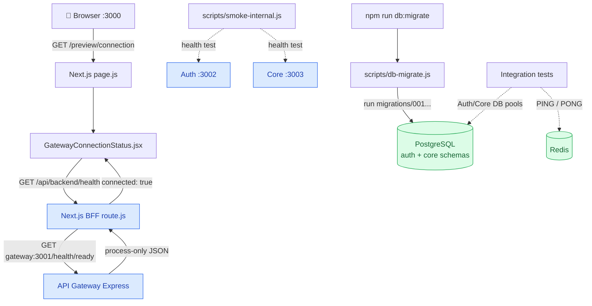
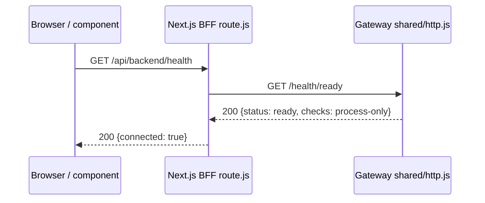

# ForgeFlow — Milestone 2 Complete

> **2A → 2D | Beginner-friendly architecture & data-flow notes**  
> **Status:** Milestone 2 complete (owner-confirmed). **Next:** Milestone 3 — Authentication.  
> **Stack:** JavaScript · Next.js 16 · Express · PostgreSQL · Redis · Docker · GitHub Actions

## 1. এই milestone-এ আসলে কী বানালাম?

| Slice | কী বানিয়েছি? | এখন কী কাজ করছে? |
|---|---|---|
| **2A — Backend Foundation** | Gateway, Auth, Core—৩টি আলাদা Express app; shared configuration, HTTP handler, logger | `/health/live`, `/health/ready`, request ID, basic error handling |
| **2B — Database Infrastructure** | PostgreSQL, Redis, restricted DB users, `node-pg-migrate`, DB pools | Schema migration, permissions ও Redis connectivity tests |
| **2C — Docker Foundation** | ৩টি backend Dockerfile, Docker networking, health checks | Gateway/Auth/Core আলাদা container-এ চলে; internal smoke test |
| **2D — BFF Connection** | Next.js BFF health route, connection UI, frontend Docker + CI | **Browser → Next.js BFF → Gateway → Browser** real request |

**মনে রাখবে:** Foundation তৈরি হয়েছে; **Register/Login, Users/Projects CRUD, Gateway→Auth/Core API routing, realtime ও Redis rate limiting এখনও তৈরি হয়নি।** `/health/ready` এখন শুধু Gateway **process-only** readiness দেখায়; পুরো system/database ready কি না তা নয়।

## 2. পুরো architecture — কোনটা কার সঙ্গে কথা বলে?



**Arrow meaning:** `→` বাস্তব HTTP call / migration; `-.->` **test-only** call। Gateway এখনও স্বাভাবিক API request Auth/Core-এ forward করে না; `smoke-internal.js` শুধু যোগাযোগ সম্ভব কি না যাচাই করে।

## 3. Actual HTTP flow: এক request-এ কোন file চলে?

Browser-এ `http://localhost:3000/preview/connection` খুললে:

1. **Frontend UI:** `src/app/preview/connection/page.js` → `src/components/connection/gateway-connection-status.jsx` render হয়। Component-এর `fetch('/api/backend/health')` call হয়।
2. **Next.js BFF:** `src/app/api/backend/health/route.js` → server-only `FORGEFLOW_GATEWAY_URL` পড়ে → `fetch('/health/ready')` করে। Browser-এ internal Gateway URL বা credential যায় না।
3. **Gateway start-up path:** `apps/api-gateway/src/server.js` → `app.js` → `shared/http.js` (`/health/ready` route)। `shared/config.js` config দেয়; `shared/start-server.js` server listen করে; `shared/logger.js` request log করে।
4. **Return path:** Gateway JSON `{service:'api-gateway',status:'ready',checks:'process-only'}` → BFF response validate করে → `{connected:true,service:'api-gateway',readiness:'process-only'}` → component-এ **Connected** দেখায়।



BFF-এর fallback আছে: Gateway URL না থাকলে **503**, unexpected response হলে **502**, timeout হলে **504**। কোনো generic URL proxy বা login token forwarding এখানে নেই।

## 4. Database flow (2B): Migrator কে, Pool কে?

**Setup (একবার নতুন PostgreSQL volume initialize হলে):**

`compose.yml` → PostgreSQL container → `docker/postgres/init/10-create-roles.sh` → তিনটি restricted role তৈরি: `forgeflow_migrator`, `forgeflow_auth`, `forgeflow_core`।

**Migration (developer/CI command):**

`npm run db:migrate` → `scripts/db-migrate.js` → `shared/db-config.js` (Migrator credentials) → `migrations/001_create_service_schemas.js` → PostgreSQL-এর `auth`/`core` schema ও permissions তৈরি। `public.pgmigrations` কোন migration চলেছে তা track করে; আবার চালালে একই migration পুনরায় প্রয়োগ হয় না।

**Runtime DB code প্রস্তুত (কিন্তু business endpoint-এ এখনও wired নয়):**

- `apps/auth-service/src/db/pool.js` → `readDbConfig('auth')` → `pg.Pool` → শুধু `auth` schema-এর অনুমতি।
- `apps/core-service/src/db/pool.js` → `readDbConfig('core')` → `pg.Pool` → শুধু `core` schema-এর অনুমতি।
- `tests/integration/infrastructure.test.js` এই pools দিয়ে permission/connection check করে; Redis-কে `PING` পাঠিয়ে `PONG` পায়।

**কেন Migrator আলাদা?** Migrator **structure বদলায়** (table/schema/migration); Auth/Core পরে **data read/write** করবে। Application-কে `CREATE/DROP` permission না দিয়ে accidental/destructive changes-এর risk কমানো হয়েছে। **Migrator কোনো microservice নয়**, একটি privileged DB role ও CLI migration process।

**এখন database-এ business tables নেই** (`users`, `workspaces`, `projects` পরের phases-এ আসবে)। Redis-ও এখনও cache/queue/rate-limiter হিসেবে application traffic handle করছে না।

## 5. Docker flow (2C–2D): Port আর service name

| Compose file | কী চালায়? |
|---|---|
| Backend `compose.yml` | `postgres`, `redis` |
| Backend `compose.apps.yml` | `gateway`, `auth`, `core` |
| Backend `compose.frontend.yml` | Sibling repo-র `frontend` |

| PC / Windows থেকে | Docker network-এর ভেতরে |
|---|---|
| Frontend: `127.0.0.1:3000` | `frontend:3000` |
| Gateway: `127.0.0.1:3001` | `gateway:3001` |
| PostgreSQL: `127.0.0.1:5433` | `postgres:5432` |
| Redis: `127.0.0.1:6380` | `redis:6379` |
| Auth/Core host port publish করা হয়নি | `auth:3002`, `core:3003` |

**কেন দুই URL?** `localhost` মানে **যে container/PC থেকে call হচ্ছে সেই নিজস্ব machine**। Frontend container থেকে Gateway-তে যেতে `http://gateway:3001` লাগে—`localhost:3001` নয়। Local `npm run dev` frontend-এর `.env.local`-এ server-only URL `http://127.0.0.1:3001` হতে পারে; Docker Compose frontend-এর environment-এ `http://gateway:3001`।

**Dockerfile** image বানায়; **Compose** কোন image কী environment/port/network নিয়ে চালাবে সেটি নির্ধারণ করে; **healthcheck** process respond করছে কি না যাচাই করে। PostgreSQL/Redis **named volumes** container restart-এর পর data ধরে রাখে।

## 6. দ্রুত file map — কোথায় খুঁজবে?

```text
E:/ForgeFlow/
├── forgeflow-frontend/                  # Repo 1
│   ├── src/app/preview/connection/page.js
│   ├── src/components/connection/gateway-connection-status.jsx
│   ├── src/app/api/backend/health/route.js   # BFF ↔ Gateway
│   ├── tests/bff/health-route.test.jsx
│   ├── Dockerfile
│   └── .github/workflows/container-build.yml
└── forgeflow-backend/                   # Repo 2
    ├── apps/api-gateway/src/{server.js,app.js}
    ├── apps/auth-service/src/{server.js,app.js,db/pool.js}
    ├── apps/core-service/src/{server.js,app.js,db/pool.js}
    ├── shared/{config.js,start-server.js,http.js,logger.js,db-config.js}
    ├── docker/postgres/init/10-create-roles.sh
    ├── migrations/001_create_service_schemas.js
    ├── scripts/{db-migrate.js,smoke-internal.js}
    ├── compose.yml / compose.apps.yml / compose.frontend.yml
    └── .github/workflows/{ci.yml,container-build.yml}
```

## 7. How we verified it

- **Frontend:** ESLint passed, **7/7 tests passed**, Next.js production build passed; browser-এ **Connected** দেখা গেছে।
- **Backend:** **21/21 unit tests** ও **4/4 infrastructure integration tests** passed (reported during 2B); internal Docker smoke test passed (reported during 2C)।
- **Full stack:** `curl http://127.0.0.1:3000/api/backend/health` → `{"connected":true,"service":"api-gateway","readiness":"process-only"}` (confirmed)।
- **GitHub:** Two-repo PR/CI workflow; owner Milestone 2 merged/completed বলে confirm করেছেন। Current GitHub run/SHAs এই document তৈরির সময় স্বাধীনভাবে যাচাই করা হয়নি।

**Useful local commands (Git Bash; backend repo থেকে):**

```bash
docker-compose -f compose.yml -f compose.apps.yml -f compose.frontend.yml up -d --build --wait
docker-compose -f compose.yml -f compose.apps.yml -f compose.frontend.yml ps
curl http://127.0.0.1:3000/api/backend/health
# আলাদা DB migration দরকার হলে: npm run db:migrate
```

## 8. এরপর কী কী বাকি? (Roadmap)

| Phase(s) | Next major work | Complexity |
|---|---|---|
| **3** | Registration, Login, JWT, Auth.js/BFF session security | **High** |
| **4–5** | Workspaces, memberships/RBAC, Projects | **High** |
| **6–8** | Issues, persistent Kanban, Comments | Medium–High |
| **9–12** | Notifications, realtime sockets, Redis rate limits/cache, BullMQ Worker | **High** |
| **13–15** | Sandbox billing, Nginx/scaling tests, release CI/CD | **High** |
| **16–17** | Core v1.0 deploy, smoke checks, portfolio demo/docs | Medium–High |
| **18A–19** | CRM companies/contacts/deals → Won-to-project → CRM release | Medium–High |

**Progress:** Milestone/Phase **0–2 foundation complete** (owner-confirmed)। **Core v1.0-এর Phase 3–17**, তারপর **CRM v1.1-এর Phase 18–19** এখনও বাকি। সময়/শতকরা completion এখন নির্ভরযোগ্যভাবে বলা যায় না; বড় business features ও security কাজ সামনে।

> **One-line mental model:** **2A = server**, **2B = database**, **2C = containers/network**, **2D = frontend থেকে Gateway পর্যন্ত first real request**। **Milestone 3-এ** এই foundation-এর ওপর প্রথম real `Register/Login → Auth → PostgreSQL` data flow তৈরি হবে।
