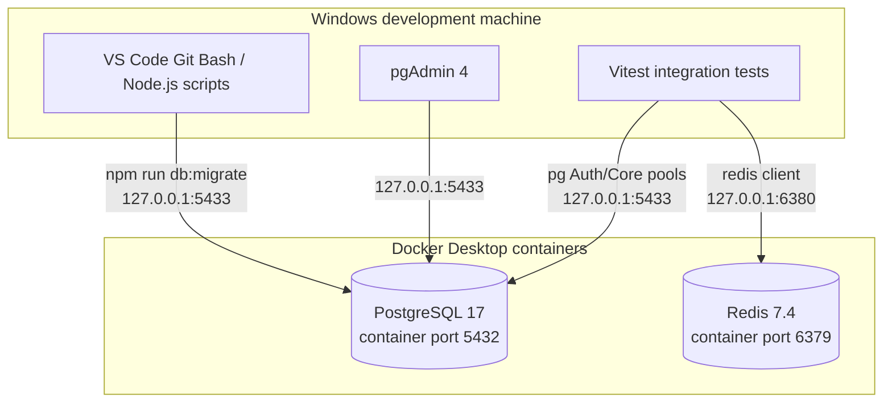
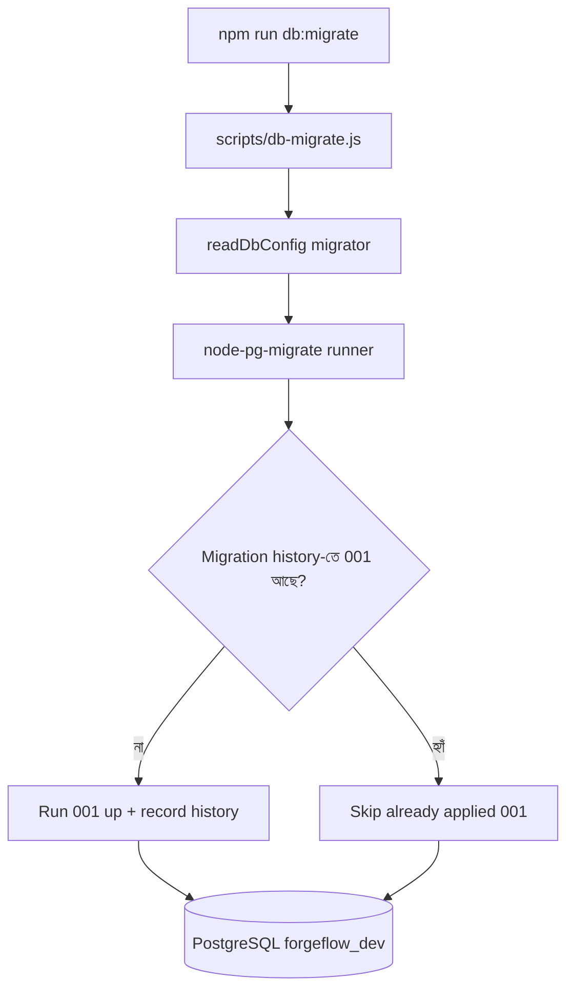
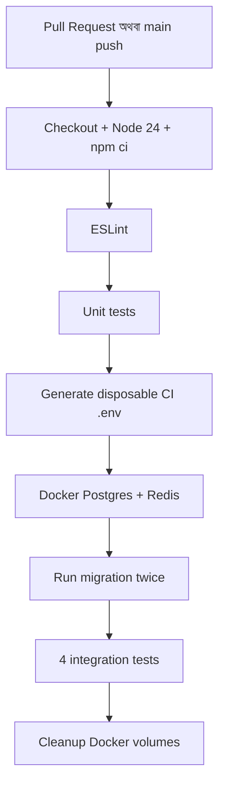

# ForgeFlow — Milestone 2B: Database Infrastructure

> **Beginner-friendly study notes (বাংলা + English technical terms)**  
> Repository: `E:\ForgeFlow\forgeflow-backend`  
> Milestone: **2B — PostgreSQL, Redis, Docker Compose, SQL Migrations, pgAdmin, Integration Tests**  
> Basis: Milestone 2B source archive, Milestone 2A backend foundation, and the local terminal results reported during implementation.
>
> **Current evidence:** Local integration tests **4/4 passed**; unit tests **21/21 passed** after separating Vitest configurations; ESLint passed. **Milestone 2B PR, GitHub CI, and merge are not verified yet.**

---

## 1. এক মিনিটে পুরো Milestone 2B

Milestone **2A**-তে আমরা তিনটি Express server তৈরি করেছিলাম:

- `api-gateway` → port `3001`
- `auth-service` → port `3002`
- `core-service` → port `3003`

এগুলো basic HTTP request এবং `/health/live`-এর মতো endpoint handle করত। তখন database ছিল না।

Milestone **2B**-তে আমরা **database infrastructure** যোগ করেছি:

1. **PostgreSQL** — ভবিষ্যতের permanent data রাখার জন্য।
2. **Redis** — ভবিষ্যতের rate limiting, caching ও background jobs-এর জন্য।
3. **Docker Compose** — PostgreSQL এবং Redis একই configuration দিয়ে চালাতে।
4. **Database roles/schemas** — Auth ও Core-এর database access আলাদা করতে।
5. **Migration** — database structure-এর পরিবর্তন repeatable ও version-controlled করতে।
6. **`pg` connection pools** — JavaScript থেকে PostgreSQL connection manage করতে।
7. **Integration tests ও CI** — বাস্তব PostgreSQL/Redis-এর সঙ্গে connection এবং permissions যাচাই করতে।

**এখনো কী হয়নি:** user/project/issue table তৈরি হয়নি; login API হয়নি; Gateway database query করে না; Auth/Core-এর business endpoints database ব্যবহার করছে না। `pool.js` তৈরি হয়েছে এবং integration tests সেটি ব্যবহার করছে—full business integration পরে আসবে।

## 2. সম্পূর্ণ architecture: এখন কোন জিনিস কোথায় আছে?



**খেয়াল করো:** এই diagram-এ browser → frontend → Gateway → Auth/Core → database flow দেখানো হয়নি, কারণ এটি এখনো বাস্তবে connect করা হয়নি। এটি future target architecture।

### Database-এর তিনটি term

| Term | অর্থ | ForgeFlow-তে উদাহরণ |
|---|---|---|
| **Database** | অনেক data object-এর container | `forgeflow_dev` |
| **Schema** | Database-এর ভেতরের namespace / grouping | `auth`, `core`, `public` |
| **Table** | Row এবং column-এ data রাখে | `auth.users` **ভবিষ্যতে** তৈরি হবে; এখন নয় |

একটি database-এর মধ্যে অনেক schema থাকতে পারে, এবং একটি schema-তে অনেক table থাকতে পারে।

```text
PostgreSQL server
└── Database: forgeflow_dev
    ├── Schema: auth
    │   └── Future users, sessions, reset tables
    ├── Schema: core
    │   └── Future workspaces, projects, issues, CRM tables
    └── Schema: public
        └── pgmigrations  (migration history)
```

**কেন দুই schema কিন্তু একটা database?** শেখার জন্য এবং প্রথম release-এর complexity কমাতে। Auth ও Core আলাদা role পায়, কিন্তু database infrastructure এখনো shared—তাই database outage বা migration change উভয় service-কে প্রভাবিত করতে পারে।

---

## 3. Docker Compose কী করেছে?

ফাইল: **`compose.yml`**

এখানে দুটি **service** define করা হয়েছে:

| Compose service | Image | Windows host port | Container port |
|---|---|---:|---:|
| `postgres` | `postgres:17-alpine` | `5433` | `5432` |
| `redis` | `redis:7.4-alpine` | `6380` | `6379` |

উদাহরণ:

```yaml
ports:
  - "127.0.0.1:5433:5432"
```

এর অর্থ: Windows-এ `127.0.0.1:5433`-এ connect করলে Docker request-টি PostgreSQL container-এর `5432` port-এ পাঠাবে। `127.0.0.1` ব্যবহারের কারণে portটি local computer-এ সীমাবদ্ধ রাখা হয়েছে।

**Important:** Windows-এ তোমার কাজের command হলো `docker-compose` (hyphen সহ)। GitHub Actions-এর Linux runner-এ workflow `docker compose` ব্যবহার করে।

```bash
# VS Code Git Bash, backend repository-তে
cd /e/ForgeFlow/forgeflow-backend
docker-compose up -d --wait postgres redis
docker-compose ps
```

- `up` → service start করে।
- `-d` → background-এ চালায়; terminal free থাকে।
- `--wait` → health checks healthy হওয়া পর্যন্ত অপেক্ষা করে।
- `ps` → containers-এর status দেখায়।

### Health check বনাম data

- PostgreSQL container-এর `pg_isready` দিয়ে database server request নিতে প্রস্তুত কি না check হয়।
- Redis container-এর `redis-cli ping` দিয়ে Redis সাড়া দিচ্ছে কি না check হয়।
- **এগুলো data ঠিক আছে বা full application ready—তার guarantee নয়।**

### Volume কেন?

`compose.yml`-তে `postgres_data` এবং `redis_data` named volume আছে। Container restart বা recreate হলেও data volume-এ থেকে যেতে পারে। Redis-এ `appendonly yes` persistence configure করা হয়েছে এবং `noeviction` policy দেওয়া আছে।

```bash
docker-compose restart postgres  # data থাকে
docker-compose down              # containers বন্ধ; volumes থাকে
```

**সতর্কতা:** `docker-compose down -v` চালালে Compose-managed named volumes-ও delete হতে পারে—local database data হারানোর ঝুঁকি আছে। শেখার সময় এটা না চালানোই ভালো।

---

## 4. `.env.example` এবং `.env` — কেন দুইটা file?

- **`.env.example`** হলো Git-এ রাখার মতো configuration template। এখানে আসল password থাকবে না।
- **`.env`** হলো তোমার নিজের computer-এর local configuration; এতে real local passwords থাকে। Gitignore দিয়ে এটি commit থেকে বাদ রাখা উচিত।

উদাহরণ (password অংশ ইচ্ছাকৃতভাবে বাদ দেওয়া হয়েছে):

```env
DB_HOST=127.0.0.1
DB_PORT=5433
DB_NAME=forgeflow_dev
REDIS_URL=redis://127.0.0.1:6380
```

আর চার ধরনের password আলাদা:

| Variable | উদ্দেশ্য |
|---|---|
| `POSTGRES_PASSWORD` | PostgreSQL bootstrap admin role |
| `MIGRATOR_DB_PASSWORD` | Schema/migration change করার role |
| `AUTH_DB_PASSWORD` | Auth service-এর সীমিত DB access |
| `CORE_DB_PASSWORD` | Core service-এর সীমিত DB access |

**কেন আলাদা?** Auth service compromise হলে যেন সহজে Core schema ব্যবহার বা schema structure পরিবর্তন করা না যায়। এটাকে বলে **least privilege**: যে কাজের জন্য যত permission দরকার, তার বেশি দেওয়া হবে না।

**দুটি আলাদা loading mechanism:**

1. `docker-compose` `.env` থেকে `${...}` variables বসিয়ে container configuration তৈরি করে।
2. `node --env-file-if-exists=.env ...` Node.js process-এর `process.env`-এ variables দেয়।

একই `.env` file ব্যবহার হলেও কাজ দুটি ভিন্ন।

---

## 5. Database role আর schema permission

PostgreSQL-এ **role** হলো database identity যার permissions নির্ধারণ করা যায়। এখানে:

| Role | Intended access |
|---|---|
| `forgeflow_admin` | Container initialization-এর admin |
| `forgeflow_migrator` | Migration ও schema creation |
| `forgeflow_auth` | `auth` schema-তে অনুমোদিত data operations |
| `forgeflow_core` | `core` schema-তে অনুমোদিত data operations |

`forgeflow_auth`-কে `core` schema access দেওয়া হয়নি; `forgeflow_core`-কে `auth` schema access দেওয়া হয়নি। কোনো app runtime role-কে schema **CREATE** privilege দেওয়া হয়নি।

আমাদের integration tests সরাসরি `has_schema_privilege(...)` SQL দিয়ে এটি verify করেছে।

### এক লাইনের permission error: আমরা কী শিখেছি?

প্রথম migration চালানোর সময় এই error হয়েছিল:

```text
CREATE SCHEMA "auth";
permission denied for database forgeflow_dev
```

এর অর্থ **database connection সফল**, কিন্তু migrator-এর ওই database-এ নতুন schema তৈরি করার permission ছিল না। `public` schema-তে `CREATE` privilege থাকা আর **database-এ schema CREATE** privilege থাকা এক জিনিস নয়।

Existing local database-এর জন্য আমরা এই SQL grant ব্যবহার করেছি:

```sql
GRANT CREATE ON DATABASE forgeflow_dev TO forgeflow_migrator;
```

**এটি permanent করতে source file-ও ঠিক করতে হবে:** `docker/postgres/init/10-create-roles.sh`-এর SQL block-এ নিম্নের grant থাকতে হবে:

```sql
GRANT CREATE ON DATABASE :"db_name" TO forgeflow_migrator;
```

> ⚠️ **Source review finding:** মূল 2B ZIP-এর initialization script-এ এই `GRANT CREATE ON DATABASE` লাইনটি নেই। তুমি local database-এ manual grant দিয়ে migration সফল করেছ, কিন্তু repository file-এ এই fix commit হয়েছে কি না এখানে verify করা হয়নি। **PR দেওয়ার আগে source file-এ line-টি নিশ্চিত করো**, না হলে GitHub CI-এর fresh database-এ একই permission error আসতে পারে।

### `docker/postgres/init/10-create-roles.sh` বনাম migration

এই দুটিকে confuse করা সহজ:

- **Initialization script:** PostgreSQL-এর **একদম নতুন, empty data volume**-এর first initialization-এ `forgeflow_auth`, `forgeflow_core`, `forgeflow_migrator` role তৈরি করে এবং initial access দেয়।
- **Migration script:** Database initialized হওয়ার **পরে**, versioned schema changes apply করে। নতুন migration থাকলে আবার চালানো যায়।

Initialization script **প্রতিবার `docker-compose up`-এ চলে না**। `.env`-এর password পরে বদলালেও existing database role-এর password নিজে থেকে পরিবর্তন হয় না।

---

## 6. Migration আসলে কী? সবচেয়ে গুরুত্বপূর্ণ অংশ

ধরো আজ শুধু `auth` schema বানালে। আগামী সপ্তাহে `users` table; তার পরের সপ্তাহে `projects` table। অন্য developer বা CI environment কীভাবে জানবে database-এ কোন কোন change apply করতে হবে?

**Migration** = database structure-এর পরিবর্তন code file হিসেবে রাখা, যার version/order আছে।

Milestone 2B-এর migration file:

```text
migrations/001_create_service_schemas.js
```

`001` মানে এটি আমাদের প্রথম ordered migration। এটি **`auth` এবং `core` schema** তৈরি করে, roles-এর permission set করে। Domain tables তৈরি করে না।

### `up` — change apply

Actual file-এর মূল অংশ:

```javascript
export const up = (pgm) => {
  pgm.createSchema("auth");
  pgm.createSchema("core");

  pgm.sql("GRANT USAGE ON SCHEMA auth TO forgeflow_auth");
  pgm.sql("GRANT USAGE ON SCHEMA core TO forgeflow_core");
};
```

- `export const up` → এই function migration **apply** করার জন্য।
- `pgm` → `node-pg-migrate` library থেকে পাওয়া migration builder।
- `pgm.createSchema()` → PostgreSQL-এর জন্য `CREATE SCHEMA` statement তৈরি করে।
- `pgm.sql()` → raw SQL execute করার ব্যবস্থা দেয়।

পূর্ণ file-এ আরও `ALTER DEFAULT PRIVILEGES` আছে, যাতে **মigrator দিয়ে ভবিষ্যতে তৈরি করা tables/sequences**-এ সংশ্লিষ্ট runtime role-এর permissions automatically apply হয়। এখন table নেই—তাই এটি future preparation।

### `down` — reverse change

একই file-এ `down` function আছে। এটি assigned privileges revoke করে schemas drop করার চেষ্টা করে।

```javascript
export const down = (pgm) => {
  // ... revoke privileges first
  pgm.dropSchema("core");
  pgm.dropSchema("auth");
};
```

এটি শেখার জন্য গুরুত্বপূর্ণ; **কিন্তু এখন down/rollback manually চালাবে না**। Source-এ `CASCADE` নেই: future domain tables থাকলে সহজে সেগুলোসহ সব drop না করার জন্য rollback fail করাটাই safer।

### Migration কীভাবে execute হয়?



`node-pg-migrate` migration history রাখে `public.pgmigrations` table-এ। এজন্য:

```bash
npm run db:migrate
npm run db:migrate
```

একই migration দুইবার execute হয় না। একবার apply হলে পরের run history দেখে সেটি skip করে। এটাকে বলা যায় **repeat-safe migration execution**; migration-এর ভেতরের arbitrary SQL সবক্ষেত্রে idempotent এমন দাবি নয়।

### `scripts/db-migrate.js` file

এটি `node-pg-migrate`-এর `runner()`-কে configure করে:

- `readDbConfig("migrator")` → migrator credentials নেয়।
- `dir` → `migrations/` folder দেখায়।
- `direction: "up"` → pending migrations apply করে।
- `singleTransaction: true` → migration batch transaction-এ করার configuration।
- `checkOrder: true` → migration ordering enforce করার চেষ্টা।
- Failed হলে message print করে non-zero exit status দেয়।

**কেন Gateway/Auth/Core নিজে migration চালাবে না?** একসাথে বহু server replica startup করলে conflict হতে পারে। তাই migration একটি **explicit, একক operation**।

---

## 7. Node.js থেকে PostgreSQL কীভাবে connect হচ্ছে?

এখানে তিনটি জিনিস আলাদা:

1. **`shared/db-config.js`** → host/port/database/password **validate** করে।
2. **`pg` library** → PostgreSQL-এর সঙ্গে communication করে।
3. **`apps/.../src/db/pool.js`** → database connections-এর **pool** তৈরি করে।

### `shared/db-config.js`

```javascript
const config = readDbConfig("auth");
```

`readDbConfig("auth")`-এর উদ্দেশ্য হলো এমন config object return করা:

```javascript
{
  host: "127.0.0.1",
  port: 5433,
  database: "forgeflow_dev",
  user: "forgeflow_auth",
  password: "<password-from-env>",
  connectionTimeoutMillis: 3000
}
```

এটি **শুধু explanation-এর example**—real password file-এ লিখবে না। Module-এর `Zod` schema password-এ minimum 16 characters, port valid number ইত্যাদি check করে। Account name hardcoded mapping দিয়ে `auth`/`core`/`migrator` select হয়, তাই Auth Service অনিচ্ছাকৃতভাবে migrator identity নিয়ে চালু হওয়ার কথা নয়।

### Connection pool কী?

যদি প্রতিটি HTTP request-এর জন্য নতুন database connection খুলি, request শেষ হলে বন্ধ করি—তাহলে overhead বাড়বে।

**Pool** = কয়েকটি connection reuse করার manager।

Actual Auth file:

```javascript
import pg from "pg";
import { readDbConfig } from "../../../../shared/db-config.js";

export function createAuthPool(environment = process.env) {
  const config = readDbConfig("auth", environment);

  return new pg.Pool({
    ...config,
    max: 5,
    idleTimeoutMillis: 10000,
  });
}
```

- `pg.Pool` → `pg` library-এর connection pool।
- `...config` → config object-এর properties copy করে।
- `max: 5` → এই pool একসাথে সর্বোচ্চ 5 database connections রাখতে পারে।
- `idleTimeoutMillis: 10000` → idle connection প্রায় 10 সেকেন্ড পরে close হওয়ার setting।

Core-এর pool-ও একই, শুধু `readDbConfig("core")` ব্যবহার করে।

**Important:** Pool object তৈরি করলেই 5টি connection সঙ্গে সঙ্গে খুলতে হবে এমন নয়। দরকার হলে pool connection acquire করে। `pg.Pool`-এ query চালানো যায় এবং কাজ শেষে pool close করা যায়।

Future feature-এর সহজ example (এখনকার business API-তে নেই):

```javascript
const pool = createAuthPool();
const result = await pool.query("SELECT CURRENT_USER AS username");
console.log(result.rows[0].username);
await pool.end();
```

এই example read-only query; real business SQL পরে repository layer-এ রাখব।

---

## 8. Redis কী করছে?

Redis হলো দ্রুত data access-এর জন্য একটি আলাদা server। PostgreSQL আমাদের **authoritative permanent application data** রাখবে; Redis পরে rate-limit counters, cache ও job queue-এর মতো কাজে ব্যবহার হবে।

Milestone 2B-তে Redis client দিয়ে শুধু **connection verify** করেছি।

```javascript
const redisClient = createClient({
  url: process.env.REDIS_URL || "redis://127.0.0.1:6380",
});

await redisClient.connect();
const reply = await redisClient.ping(); // "PONG"
```

এটি concept illustration; actual integration test-এ timeout, reconnect behavior এবং cleanup-ও আছে।

**এখন Redis দিয়ে real cache, Gateway rate limiter বা BullMQ job চালানো হচ্ছে না।** সেগুলো later milestones।

---

## 9. কোন file কেন তৈরি হলো? Full map

```text
forgeflow-backend/
├── compose.yml                           # PostgreSQL + Redis containers
├── .env.example                         # Public configuration template
├── .env                                 # Local secrets; never commit
├── package.json                         # npm scripts, dependencies, workspaces
├── package-lock.json                    # Locked dependency versions
├── docker/
│   └── postgres/init/
│       └── 10-create-roles.sh           # First-boot DB roles/permissions
├── migrations/
│   └── 001_create_service_schemas.js    # Auth/Core schema migration
├── scripts/
│   ├── db-migrate.js                    # Run pending migrations
│   └── db-seed.js                       # No-op placeholder in 2B
├── shared/
│   └── db-config.js                     # DB config validation
├── apps/
│   ├── auth-service/src/db/pool.js       # Restricted Auth pg pool
│   └── core-service/src/db/pool.js       # Restricted Core pg pool
├── tests/
│   ├── db-config.test.js                # Unit test of config
│   └── integration/
│       └── infrastructure.test.js       # Real Postgres/Redis tests
├── vitest.config.js                     # Unit tests only (local fix)
├── vitest.integration.config.js         # Integration tests only
├── docs/
│   ├── database-infrastructure.md       # Practical setup/troubleshooting
│   ├── erd.md                           # DB ownership (no domain tables yet)
│   └── api.md                           # Current health-only API contract
└── .github/workflows/ci.yml            # Backend CI pipeline
```

**মনে রাখবে:** 2B package-এ 16টি new/updated source file ছিল; `package.json`, `package-lock.json`, `vitest.config.js`-এর মতো কিছু project file local কাজের সময় modify হয়েছে।

### File-by-file সংক্ষেপে

| File | এক লাইনের কাজ | এখন কেন দরকার |
|---|---|---|
| `compose.yml` | Container definition | একই DB/Redis environment বারবার চালাতে |
| `.env.example` | Settings template | নতুন developer setup বুঝতে |
| `10-create-roles.sh` | Initial DB accounts | Runtime ও migrator access আলাদা করতে |
| `001_create_service_schemas.js` | Versioned schema change | Database structure Git-এ track করতে |
| `scripts/db-migrate.js` | Migration runner | Controlledভাবে change apply করতে |
| `scripts/db-seed.js` | Future seed script | Demo data আলাদা process রাখতে; বর্তমানে no-op |
| `shared/db-config.js` | Settings validation | ভুল port/password setup early detect করতে |
| Auth `pool.js` | Auth DB pool | Own restricted connection reuse করতে |
| Core `pool.js` | Core DB pool | Auth থেকে আলাদা permission রাখতে |
| `tests/db-config.test.js` | Pure configuration tests | Docker ছাড়াই validation test করতে |
| `tests/integration/infrastructure.test.js` | Real resource tests | Schema, permission, Redis verify করতে |
| `vitest.integration.config.js` | Integration test selector | Unit tests থেকে আলাদা করতে |
| `docs/erd.md` | DB ownership notes | Future tables কার হবে বোঝাতে |
| `docs/api.md` | Current endpoints | কী আছে/নেই clear রাখতে |
| `.github/workflows/ci.yml` | Automated CI steps | PR-এর code disposable infrastructure-এ test করতে |

---

## 10. Testing-এর এত file কেন? কীভাবে আলাদা?

### A. Unit tests: Docker ছাড়াই

```bash
npm test
```

এই project-এ unit test বলতে function/config/HTTP skeleton-কে isolatedভাবে test করছি। তোমার শেষ output অনুযায়ী **21 tests passed**। Pino logs দেখা স্বাভাবিক।

### B. Integration tests: সত্যিকারের DB/Redis নিয়ে

```bash
npm run test:integration
```

এই command `.env` load করে আলাদা Vitest configuration ব্যবহার করে। তোমার output অনুযায়ী **4 tests passed**:

1. Migration history-তে expected migration আছে; `auth`, `core` schema আছে।
2. Auth role নিজের schema access পায়; Core schema নয়; schema create করতে পারে না।
3. Core role নিজের schema access পায়; Auth schema নয়; schema create করতে পারে না।
4. Redis `PING`-এ `PONG` দেয়।

### `npm test`-এ যে error হয়েছিল

```text
Invalid auth database configuration. Check .env.
```

তখন integration tests ভুল করে normal `npm test`-এর মধ্যেও run হচ্ছিল। Normal command-এ `.env` load ছিল না, তাই failed suite দেখা যাচ্ছিল, যদিও আলাদা integration tests pass করছিল।

**Local fix:** `vitest.config.js`-এ normal tests সরাসরি `tests/` folder থেকে select করো:

```javascript
import { defineConfig } from "vitest/config";

export default defineConfig({
  test: {
    environment: "node",
    include: ["tests/*.test.js"],
    clearMocks: true,
  },
});
```

অন্যদিকে `vitest.integration.config.js`-এ শুধু `tests/integration/**/*.test.js` থাকে।

**কেন separation useful?** Database unavailable হলেও unit tests চালানো যাবে। Integration tests শুধু database তৈরি/healthy করার পর run হবে।

---

## 11. GitHub Actions CI কীভাবে চলছে?

ফাইল: `.github/workflows/ci.yml`



- **`npm ci`** → lockfile অনুযায়ী exact dependency installation।
- **CI `.env`** → GitHub runner-এ নতুন random credentials; তোমার local passwords GitHub-এ পাঠাতে হয় না।
- **Run migration twice** → প্রথম run apply, দ্বিতীয় run previously applied migration skip করছে কি না check।
- **CI integration tests** → actual disposable PostgreSQL ও Redis-এর বিরুদ্ধে tests।
- **`docker compose down -v` in CI** → এখানে safe, কারণ CI test resources disposable; **local project-এ same command চালাবে না**।

**Very important:** source init script-এ `GRANT CREATE ON DATABASE` না থাকলে fresh CI Postgres-এ migration fail করতে পারে। Local database manually fix করা যথেষ্ট নয়—Git-tracked source fix-ও থাকতে হবে।

এই 2B workflow **Docker application image build করে না**। Gateway/Auth/Core application Dockerfiles এবং image build tests **Milestone 2C**-তে যোগ হবে।

---

## 12. pgAdmin কীভাবে connect হয়?

pgAdmin হলো **database management GUI**, নিজে PostgreSQL server নয়।

Windows pgAdmin → **Register → Server**:

| Setting | Value |
|---|---|
| Name | `ForgeFlow Local` |
| Host | `127.0.0.1` |
| Port | `5433` |
| Maintenance database | `forgeflow_dev` |
| Username | `forgeflow_migrator` |
| Password | `.env`-এর `MIGRATOR_DB_PASSWORD` |

Connect করার পর: `Databases → forgeflow_dev → Schemas`। `auth`, `core`, `public` দেখা উচিত। Query Tool-এ:

```sql
SELECT * FROM public.pgmigrations;
```

এতে কোন migration apply হয়েছে দেখতে পারবে। **pgAdmin local inspection-এর জন্য** migrator ব্যবহার করা হয়েছে; running Auth/Core service-এর জন্য migrator ব্যবহার করবে না।

---

## 13. Common errors: আমরা কী পেয়েছি, কেন পেয়েছি?

| Error / symptom | আসল মানে | Safe fix |
|---|---|---|
| pgAdmin `connection timeout expired` | pgAdmin server/port-এ পৌঁছাতে পারছে না | Docker running? `docker-compose ps` এবং `docker-compose port postgres 5432` check |
| `permission denied for database forgeflow_dev` | DB connect হয়, কিন্তু migrator schema CREATE করতে পারে না | DB-level `GRANT CREATE`; initialization source-এও fix |
| `Invalid auth database configuration` under `npm test` | Integration suite normal test command-এ run হচ্ছিল; `.env` load ছিল না | Unit এবং integration Vitest config আলাদা |
| `password authentication failed` | DB role/password mismatch | `.env` ও first-init credentials মিলাও; volume delete নয় |
| Port `5433` already allocated | Windows-এ port occupied | Existing listener identify; mapping এবং `.env`/pgAdmin port একসাথে change |
| Docker healthy, কিন্তু app business feature নেই | Infra ready, feature এখনও implement হয়নি | পরের milestones-এ route/service/repository লিখব |

### Debug commands (Git Bash)

```bash
cd /e/ForgeFlow/forgeflow-backend

docker-compose ps
docker-compose port postgres 5432
docker-compose logs --tail=30 postgres

npm run db:migrate
npm run lint
npm test
npm run test:integration
```

**Secrets সতর্কতা:** `.env` বা password terminal output/screenshot-এ share করবে না। Debugging-এ status ও sanitized error যথেষ্ট।

---

## 14. এখন তুমি কোন অংশ আগে বুঝবে? Learning order

এই module-এর প্রতিটি line আজই মুখস্থ করতে হবে না। এই order-এ শেখো:

1. **PostgreSQL vs Redis** — কোন data কোথায় এবং কেন।
2. **Docker Compose ports ও volumes** — container কীভাবে Windows-এর সঙ্গে connect হয়।
3. **Database, schema, table** — hierarchy বোঝা।
4. **Roles ও privileges** — Auth/Core/Migrator কেন আলাদা।
5. **Migration `up`/`down`** — কেন versioned DB changes দরকার।
6. **`pg.Pool`** — Node.js থেকে DB connection reuse।
7. **Unit vs integration tests** — কোন test কোন ধরনের problem ধরে।
8. **CI workflow** — একই checks নতুন machine-এ automatically চালানো।

### নিজের বোঝা যাচাই করো

**Q1:** PostgreSQL container-এর ভেতর port `5432` হলেও Windows pgAdmin-এ port `5433` কেন?  
**Q2:** Migrator কেন schema create করতে পারে, অথচ Auth/Core পারে না?  
**Q3:** `.env`-এ password পরিবর্তন করলেই পুরোনো database role-এর password update হয় না কেন?  
**Q4:** `npm test` আর `npm run test:integration` আলাদা রাখার লাভ কী?  
**Q5:** `npm run db:migrate` দ্বিতীয়বার চালালে একই schema আবার create করার চেষ্টা করে না কেন?

**সরাসরি উত্তর (নিজে চেষ্টা করার পর দেখো):**

1. Docker host port `5433` থেকে container port `5432`-তে map করেছে।
2. Least privilege; শুধুমাত্র migrator schema change করে, app roles নিজ নিজ schema-তে data access করে।
3. Initialization script কেবল empty volume-এর প্রথম startup-এ চলে।
4. Pure unit tests DB ছাড়া চালানো যায়; integration tests বাস্তব infra ও credentials যাচাই করে।
5. `public.pgmigrations` history-তে applied migration track করা হয়।

---

## 15. Milestone 2B completion checklist

- [x] Docker PostgreSQL ও Redis চালু করে integration tests pass করেছে (user-reported)।
- [x] প্রথম migration permission error resolve করে migration চালানো গেছে (user-reported)।
- [x] Restricted Auth/Core schema access verify হয়েছে — 4/4 integration tests passed।
- [x] `npm run lint` passed।
- [x] `npm test` — 21/21 passed after Vitest config correction (user-reported)।
- [ ] **Confirm** `docker/postgres/init/10-create-roles.sh` source-এ DB-level `GRANT CREATE` আছে।
- [ ] Confirm fixed `vitest.config.js` এবং source changes staged/committed।
- [ ] GitHub PR open, latest Backend CI green, review, squash merge — **not yet evidenced**।
- [ ] Local `main` updated after verified merge।

**Next: Milestone 2C** — Gateway/Auth/Core-এর Dockerfiles, container app startup, graceful shutdown, image builds এবং CI build checks।

> **এক লাইনের summary:** 2A-তে server চালু করার ভিত্তি বানিয়েছি; 2B-তে database এবং Redis চালানো, secure credentials ও permissions, repeatable schema migrations এবং real infrastructure tests-এর ভিত্তি বানিয়েছি। এখনো actual business data বা API create করা শুরু করিনি।
