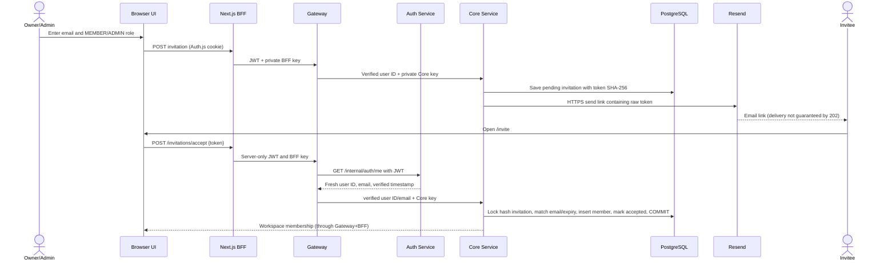

# ForgeFlow M6 — Projects & Invitations Backend Contract (snapshot implementation)

**Base:** uploaded backend `main` snapshot `0b11f19` (M5). The GitHub/Windows latest main, tests, migrations, CI, PR merge, and deployment **must be verified separately**. This document does not certify any of them.

## Migrations

- `006_create_core_projects.js`: workspace-scoped project records, active/archive, `version`, indexes.
- `007_create_workspace_invitations.js`: expiring hashed tokens, unique pending invite per workspace/email, delivery and acceptance states.
- `005_create_core_workspaces.js` is **not modified**. Never change a migration already applied; run `npm run db:migrate` from the migrator role, not at service startup.
- Existing Core application role cannot read `auth.users` identity profiles. The project and invitation tables remain in the `core` schema of the one shared PostgreSQL database.

## REST contract — Browser BFF → Gateway → Core

| Method | Gateway `/api/workspaces` suffix | Core `/internal/workspaces` suffix | Role | Response |
| --- | --- | --- | --- | --- |
| GET | `/:w/projects?page=1&limit=20&status=ACTIVE` | same | workspace member | `{projects,pagination}` |
| POST | `/:w/projects` | same | OWNER, ADMIN | `201 {project}` |
| GET | `/:w/projects/:p` | same | workspace member | `{project}` |
| PATCH | `/:w/projects/:p` | same | OWNER, ADMIN | `{project}` |
| POST | `/:w/projects/:p/archive` | same | OWNER, ADMIN | `{project}` |
| GET | `/:w/invitations` | same | OWNER, ADMIN | `{invitations}` |
| POST | `/:w/invitations` | same | OWNER, ADMIN | `202 {invitation}` |
| POST | `/:w/invitations/:i/resend` | same | OWNER, ADMIN | `202 {invitation}` |
| POST | `/:w/invitations/:i/cancel` | same | OWNER, ADMIN | `{invitation}` |
| POST | `/invitations/accept` | same | Auth-verified invited email | `{membership}` |
| PATCH | `/:w/members/:u` | same | OWNER, ADMIN (not Owner/self target) | `{member}` |
| DELETE | `/:w/members/:u` | same | OWNER, ADMIN (not Owner/self target) | `204` |

Existing `GET /:w/members` remains member-visible. Full Owner transfer is out of scope; Owner can't be invited/demoted/removed through these endpoints.

Payloads:

```json
{ "name": "Platform launch", "description": "Prepare delivery" }
```

`PATCH project`: both `name` and `description`, plus integer `expectedVersion`. `POST archive`: `{ "expectedVersion": 2 }`. A stale update gives `409 VERSION_CONFLICT`; archived projects are read-only.

`POST invitation`: `{ "email": "new.user@example.test", "role": "MEMBER" }`. Allowed roles are `MEMBER` and `ADMIN` only. `PATCH member`: `{ "role": "ADMIN" }`. `POST accept`: `{ "token": "43-CHARACTER-BASE64URL-OPAQUE-TOKEN" }`; no client-provided identity/email accepted.

## Invitation security and identity call flow



- The browser never receives raw backend JWTs/refresh tokens. Invitation token is **not** a login token.
- One-time token is 32 random bytes (43 base64url characters), expires after **7 days**, stored only as SHA-256 hash.
- The email link uses a URL fragment (`/invite#token=...`) to avoid transmitting the token on initial page GET. The browser submits it only after a button click.
- Core does not trust email from the browser or JWT payload. On accept, Gateway calls Auth `/me` using its internal Auth key, checks same verified subject, and forwards normalized email with Core-only key.
- PostgreSQL row locks and unique `(workspace_id,user_id)` prevent two concurrent acceptances.
- Creating/resending invitations is limited to **12 requests/hour per user/workspace**, accepting to **30 requests/hour/user**, via Redis shared across Gateways. Limiter errors return controlled 503. Email delivery failure records `FAILED`, allows manual resend (which replaces the token); no automatic durable queue yet.
- Only workspace OWNER/ADMIN can list pending invite emails. Demoting/removing an inviter also cancels their outstanding invitations in the same database transaction. Existing members endpoint intentionally returns user IDs/roles, not Auth-owned names/emails.

## Actual backend file chain

```text
apps/api-gateway/src/app.js
  → middleware/invitation-limits.js (invite paths only)
  → clients/core-client.js (exact allowlist)
  → apps/core-service/src/modules/workspaces/workspace.routes.js (private key + identity)
  → projects/project.controller.js OR invitations/invitation.controller.js
  → project.service.js / invitation.service.js (RBAC and rules)
  → project.repository.js / invitation.repository.js (parameterized SQL)
  → core.projects / core.workspace_invitations / core.workspace_members
```

`apps/core-service/src/server.js` wires repositories, services and the Core-only Resend mail helper. Other Auth/Gateway/M5 contracts are preserved.

## Runtime environment

Core's Node process requires `WORKSPACE_INVITE_EMAIL_MODE=resend`, `WORKSPACE_INVITE_RESEND_API_KEY`, `WORKSPACE_INVITE_EMAIL_FROM`, and `WORKSPACE_INVITE_BASE_URL` (`https://public-frontend` or `http://localhost:3000` for local only). These stay in **ignored `.env`**, never Git, browser or logs. Docker Compose privately maps the pre-existing `RESEND_API_KEY`/`AUTH_EMAIL_FROM` to Core and also needs `WORKSPACE_INVITE_BASE_URL`. If delivery is not configured, invitation creation returns 503 rather than pretending to send email.

## Tests and outstanding verification

Added Vitest tests: `tests/project-api.test.js`, `tests/invitation-api.test.js`, `tests/integration/projects-invitations.test.js`; plus dependency-free `scripts/m6-node-smoke.mjs` for basic service rules. The real integration suite must run after migration 006 and 007 in disposable PostgreSQL with Node 24. Required negative cases: foreign workspace/project IDs, Member writes, Owner protection, pending duplicate, wrong verified email, invite replay/cancel/resend, expected-version conflicts, forged identity headers and rate limits.

**Explicit limitations:** Code was authored against an uploaded Git HEAD snapshot. There is no verified local Windows Git status, no GitHub PR, no run of Vitest/PostgreSQL, no browser validation, no full production mail delivery proof and no cloud deploy. Identity names/emails for accepted workspace members need an explicit scoped Auth profile-read endpoint; showing UUIDs is deliberate interim behavior. Outbox/worker durable email retries are deferred, and email service acceptance ≠ mailbox receipt.
